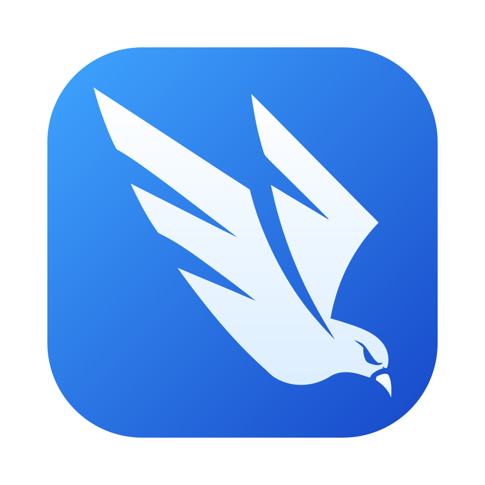
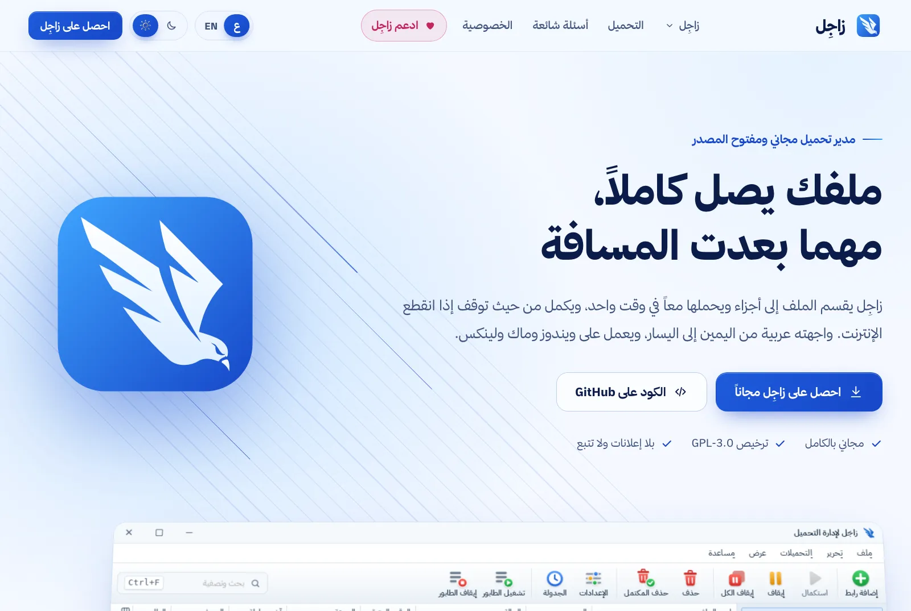
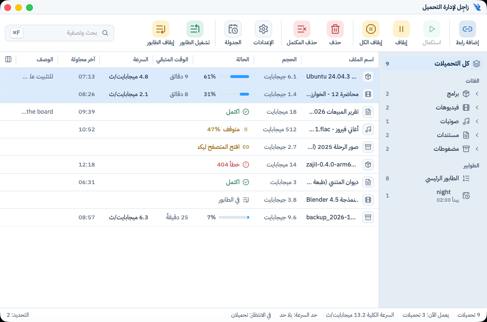
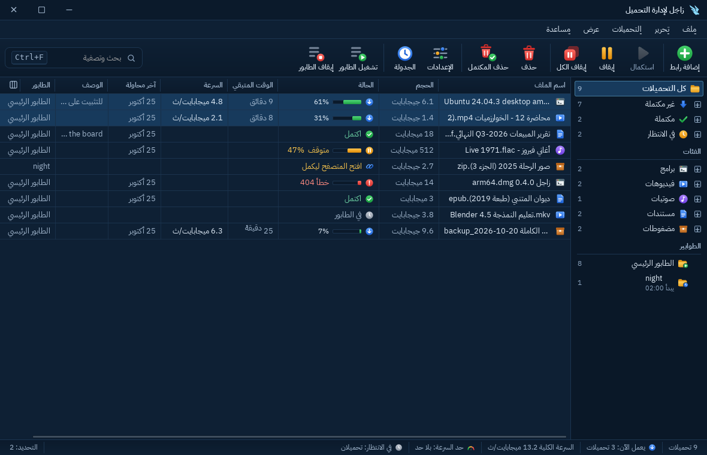
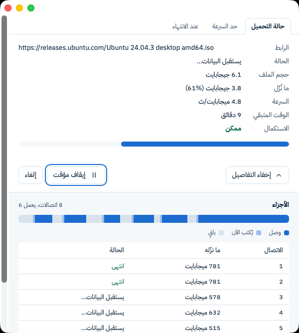
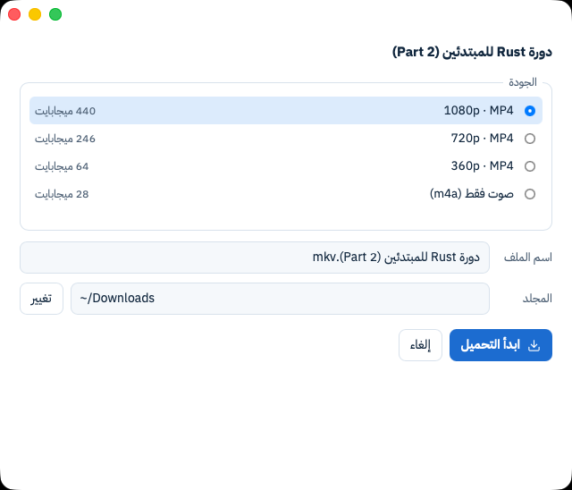
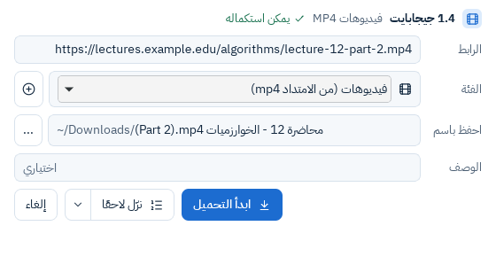
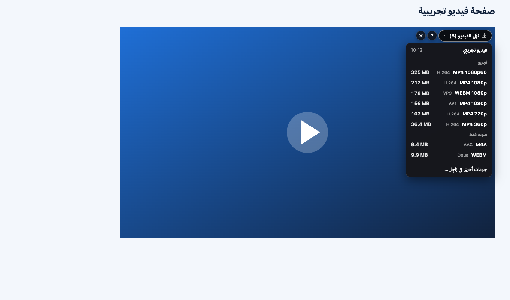
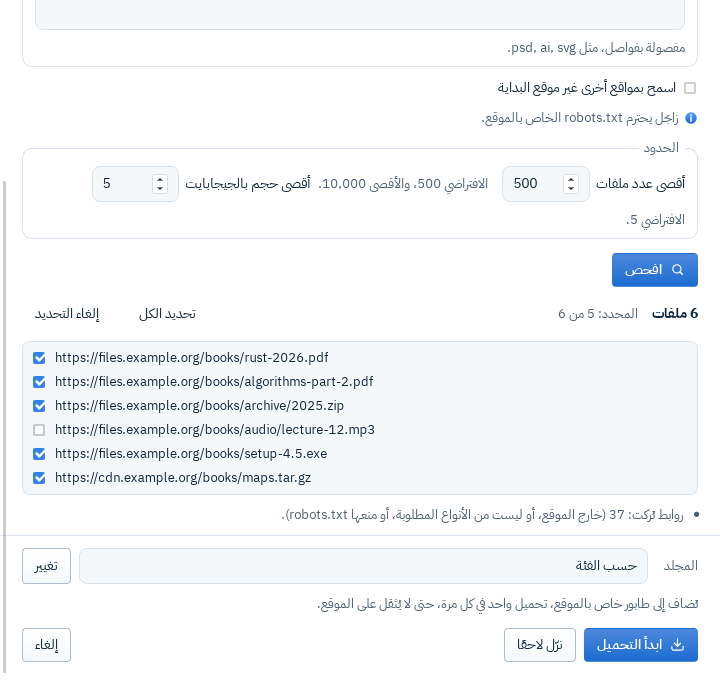
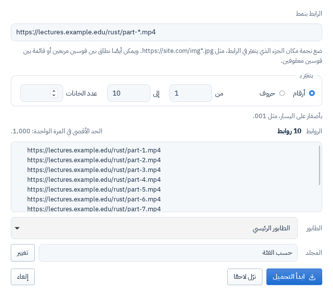

<h1>زاجِل لإدارة التحميل</h1>

<b>Zajil Download Manager</b>

ملفك يصل كاملًا، مهما بعدت المسافة.

Your file arrives whole, however far it comes from.

&nbsp;
&nbsp;

<a href="#english">English below</a>

<picture>
  <source media="(prefers-color-scheme: dark)" srcset="docs/media/site-hero-dark.webp">
  
</picture>

## زاجِل

**زاجِل** برنامج مجاني ومفتوح المصدر لإدارة التحميل، على **ويندوز وماك ولينكس**. واجهته **عربية أولًا** (من اليمين إلى اليسار)، والإنجليزية بضغطة زر.

الاسم من **الحمام الزاجل** الذي كان يوصل الرسائل مهما بعدت المسافة. وهذا ما نريده من البرنامج: أن يوصل ملفك كاملًا وسليمًا، حتى لو انقطع الاتصال في الطريق.

**[زاجِل 1.1.2](https://github.com/motalim-ai/zajil-download-manager/releases/tag/v1.1.2) منشور،** وفيه تصليحات لأدوات الفيديو وقوائم يوتيوب و«استكمال الكل» والطوابير. والجديد في 1.1: جودات يوتيوب فورًا في زر الإضافة، يحمّلها محرّك زاجِل نفسه ويستكملها، والتحميل يبدأ في الخلفية و«معلومات ملف التحميل» مفتوحة، ونوافذ تفتح فورًا، ونافذة إعدادات فيها البروكسي، وشكل جديد بأيقونات ملونة. والتحديث التلقائي الموقّع يأتي في 1.2، وما بعده في [ROADMAP](docs/ROADMAP.md).

## ما يفعله زاجِل

- **أسرع**: يقسم الملف إلى أجزاء ويحمّلها معًا، حتى 32 اتصالًا، وحين يفرغ اتصال يأخذ نصف ما بقي من أبطأ جزء.
- **لا يضيع شيء**: يكمل التحميل بعد انقطاع الإنترنت أو إغلاق البرنامج، ويتأكد أن الملف على السيرفر لم يتغير.
- **الفيديو**: في يوتيوب يعرض زر الإضافة الجودات فورًا بحجمها، ويحمّل زاجِل الصورة والصوت بعدة اتصالات ويستكملهما. ونافذة «جودة الفيديو» تعرض الجودات بحجمها، و«صوت فقط»، وقوائم التشغيل كاملة. ولا يتجاوز أي حماية DRM.
- **من المتصفح**: إضافة لـ Chrome وEdge وFirefox ترسل التحميلات إلى زاجِل، وزر «نزّل الفيديو» فوق الفيديو.
- **تنظيم**: طوابير، وجدولة بالساعة واليوم، وحد للسرعة، وفئات تلقائية، و«تحميل الموقع»، و«تحميل بالجملة».
- **عربي حقيقي**: الواجهة مصممة من اليمين إلى اليسار من البداية، بالوضع الفاتح والداكن.
- **خصوصية كاملة**: لا حساب، ولا تتبع، ولا إحصاءات، ولا إعلانات، ولا برامج مرفقة.

## صور

صور حقيقية من البرنامج (بيانات تجريبية فقط):

<table>
<tr>
<td width="50%"> النافذة الرئيسية، فاتح</td>
<td width="50%"> النافذة الرئيسية، داكن</td>
</tr>
<tr>
<td> نافذة التقدم: الأجزاء والاتصالات</td>
<td> «جودة الفيديو»</td>
</tr>
<tr>
<td> «معلومات ملف التحميل»</td>
<td> زر «نزّل الفيديو» من الإضافة</td>
</tr>
<tr>
<td> «تحميل الموقع»</td>
<td> «تحميل بالجملة»</td>
</tr>
</table>

## التحميل والتثبيت

نزّل الملف المناسب من [صفحة آخر إصدار](https://github.com/motalim-ai/zajil-download-manager/releases/latest): ويندوز 10 و11، وmacOS 11 أو أحدث، ولينكس (`.deb` وAppImage)، وإضافة Chrome وEdge وFirefox، ومعها `SHA256SUMS`.

زاجِل **غير موقّع من Apple ولا Microsoft**، فيظهر تحذير أول مرة. خطوات فتحه على كل نظام، وتركيب الإضافة، والتأكد من الملفات، في [صفحة التحميل على الموقع](https://zajil.by-wow.com/download/#install).

مصادره الرسمية الوحيدة: هذا المستودع، والموقع [zajil.by-wow.com](https://zajil.by-wow.com).

## ادعم زاجِل

زاجِل مجاني بالكامل، بلا إعلانات ولا ميزات مدفوعة، وسيبقى كذلك. والتبرع يساعد على استمرار تطويره، لكنه ليس شرطًا لأي شيء.

وتستطيع المساعدة مجانًا:

- ⭐ **نجمة على المستودع**: تساعد غيرك على أن يجد زاجِل.
- 🐞 **أبلغ عن مشكلة** أو اقترح فكرة في [Issues](https://github.com/motalim-ai/zajil-download-manager/issues)، بالعربية أو بالإنجليزية.
- 🌐 **ساعد في الترجمة**: نصوص الواجهة في [ملفات الترجمة](locales).
- 📣 **أخبر غيرك عن زاجِل**، وشارك رابط [الموقع](https://zajil.by-wow.com).

## ما لن يفعله زاجِل

- لن يتجاوز أي حماية للمحتوى (DRM).
- لن يجمع أي بيانات عنك.
- لن يعتمد على تعريف داخل النظام (kernel driver).

التفاصيل في [وثيقة المتطلبات](docs/PRD.md).

## الوثائق

| الوثيقة | المحتوى |
|---|---|
| [docs/PRD.md](docs/PRD.md) | المتطلبات، ومن المستخدم، وما يفعله البرنامج وما لا يفعله |
| [docs/ARCHITECTURE.md](docs/ARCHITECTURE.md) | بنية البرنامج: المحرّك، وسطر الأوامر، والواجهة، والإضافة |
| [docs/ROADMAP.md](docs/ROADMAP.md) | المراحل وشروط نجاح كل مرحلة |
| [docs/PARITY.md](docs/PARITY.md) | مقارنة ميزات IDM العامة بما يقدمه زاجِل |
| [docs/adr/](docs/adr/) | سجل القرارات المعمارية |
| [docs/DEPENDENCIES.md](docs/DEPENDENCIES.md) | سجل تراخيص المكتبات |
| [CONTRIBUTING.md](CONTRIBUTING.md) | كيف تساهم، وقاعدة الغرفة النظيفة |
| [AGENTS.md](AGENTS.md) | قواعد العمل لأي جلسة تبني المشروع |
| [SECURITY.md](SECURITY.md) | كيف تبلّغ عن ثغرة أمنية |

## الرخصة

زاجِل برنامج حر بترخيص [GPL-3.0-or-later](LICENSE).

لتحميل الفيديو، ينزّل زاجِل بموافقتك ffmpeg وffprobe من بنائه الخاص لمشروع FFmpeg. FFmpeg ملك أصحابه ([ffmpeg.org](https://ffmpeg.org))، وترخيصه LGPL 2.1 أو أحدث، ومصدر النسخة التي ينزّلها زاجِل وطريقة بنائها في [إصدار tools-ffmpeg-8.1.3-1](https://github.com/motalim-ai/zajil-download-manager/releases/tag/tools-ffmpeg-8.1.3-1).

This software uses code of [FFmpeg](https://ffmpeg.org) licensed under the [LGPLv2.1](https://www.gnu.org/licenses/old-licenses/lgpl-2.1.html) and its source can be downloaded [here](https://github.com/motalim-ai/zajil-download-manager/releases/tag/tools-ffmpeg-8.1.3-1).

## تنبيه

زاجِل مشروع مستقل، ولا علاقة له بشركة Tonec ولا ببرنامج Internet Download Manager (IDM). كُتب من الصفر، اعتمادًا على المعايير المنشورة ووثائق المتصفحات الرسمية فقط. التفاصيل في [قاعدة الغرفة النظيفة](CONTRIBUTING.md#قاعدة-الغرفة-النظيفة).

---

&nbsp;
&nbsp;

## Zajil

**Zajil** is a free and open-source download manager for **Windows, macOS and Linux**. Its interface is **Arabic first** (right to left), with English in one click.

Zajil is Arabic for the **homing pigeon**, which carried messages however far they had to go. That is what we want from the program: your file gets to you whole and sound, even if the connection breaks on the way.

**[Zajil 1.1.2](https://github.com/motalim-ai/zajil-download-manager/releases/tag/v1.1.2) is out,** with fixes for the video tools, YouTube playlists, «Resume all» and queues. New in 1.1: YouTube's qualities at once in the extension's button, downloaded and resumed by Zajil's own engine; the download starting in the background while “Download file info” is open; windows that open at once; a Settings window with the proxy; and a new look with coloured icons. Signed automatic updates come in 1.2; what comes next is in the [ROADMAP](docs/ROADMAP.md).

## What Zajil does

- **Faster**: it splits a file into parts and downloads them together, up to 32 connections, and when a connection is free it takes half of what is left of the slowest part.
- **Nothing is lost**: downloads go on after the connection drops or the program closes, and Zajil makes sure the file on the server has not changed.
- **Videos**: on YouTube the extension's button lists the qualities at once with their sizes, and Zajil downloads the picture and the sound over several connections, resumable. The “Video quality” window shows each quality with its size, “Sound only”, and whole playlists. It never gets around DRM.
- **From the browser**: an extension for Chrome, Edge and Firefox hands downloads to Zajil, with a “Download video” button over videos.
- **Organised**: queues, scheduling by hour and day, speed limits, automatic categories, “Site grabber” and “Batch download”.
- **Truly Arabic**: the interface was built right to left from the start, in light and dark modes.
- **Fully private**: no account, no tracking, no analytics, no ads, nothing bundled.

## Screenshots

Real screenshots of the program, in Arabic (test data only):

<table>
<tr>
<td width="50%"> The main window, light</td>
<td width="50%"> The main window, dark</td>
</tr>
<tr>
<td> The progress window: parts and connections</td>
<td> “Video quality”</td>
</tr>
<tr>
<td> “Download file info”</td>
<td> The extension's “Download video” button</td>
</tr>
<tr>
<td> “Site grabber”</td>
<td> “Batch download”</td>
</tr>
</table>

## Download and install

Get your file from the [latest release](https://github.com/motalim-ai/zajil-download-manager/releases/latest): Windows 10 and 11, macOS 11 or later, Linux (`.deb` and AppImage), and the Chrome, Edge and Firefox extension, with `SHA256SUMS`.

Zajil is **not signed by Apple or Microsoft**, so a warning shows the first time. How to open it on each system, add the extension and check the files is on [the site's download page](https://zajil.by-wow.com/en/download/#install).

Its only official sources are this repository and the site, [zajil.by-wow.com](https://zajil.by-wow.com/en/).

## Support Zajil

Zajil is completely free, with no ads and no paid features, and will stay that way. A donation helps keep it going, but it is never required.

You can also help for free:

- ⭐ **Star the repository**: it helps others find Zajil.
- 🐞 **Report a problem** or suggest an idea in [Issues](https://github.com/motalim-ai/zajil-download-manager/issues), in Arabic or English.
- 🌐 **Help with translation**: the interface's text is in the [translation files](locales).
- 📣 **Tell others about Zajil**, and share the [site](https://zajil.by-wow.com/en/).

## What Zajil will not do

- Get around any content protection (DRM).
- Collect any data about you.
- Rely on a driver inside the system (kernel driver).

The details are in the [requirements](docs/PRD.md).

## Documents

| Document | What it covers |
|---|---|
| [docs/PRD.md](docs/PRD.md) | Requirements, who the users are, and what the program does and does not do |
| [docs/ARCHITECTURE.md](docs/ARCHITECTURE.md) | How it is built: the engine, the command line, the interface and the extension |
| [docs/ROADMAP.md](docs/ROADMAP.md) | The milestones and what each must pass |
| [docs/PARITY.md](docs/PARITY.md) | IDM's public features compared with Zajil's |
| [docs/adr/](docs/adr/) | Architecture decision records |
| [docs/DEPENDENCIES.md](docs/DEPENDENCIES.md) | Licences of the libraries |
| [CONTRIBUTING.md](CONTRIBUTING.md) | How to contribute, and the clean-room rule |
| [AGENTS.md](AGENTS.md) | Working rules for every session that builds the project |
| [SECURITY.md](SECURITY.md) | How to report a security issue |

## Licence

Zajil is free software under [GPL-3.0-or-later](LICENSE). For video, Zajil downloads, once you agree, ffmpeg and ffprobe from its own build of FFmpeg (LGPL 2.1 or later; [source and build](https://github.com/motalim-ai/zajil-download-manager/releases/tag/tools-ffmpeg-8.1.3-1)).

## Notice

Zajil is an independent clean-room project. It is not affiliated with Tonec or Internet Download Manager (IDM). It was written from scratch, from published standards and the browsers' official documentation only. See the [clean-room rule](CONTRIBUTING.md).
