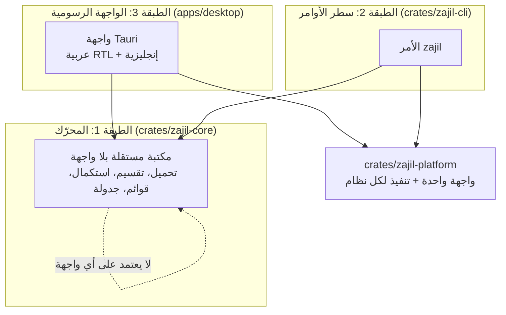
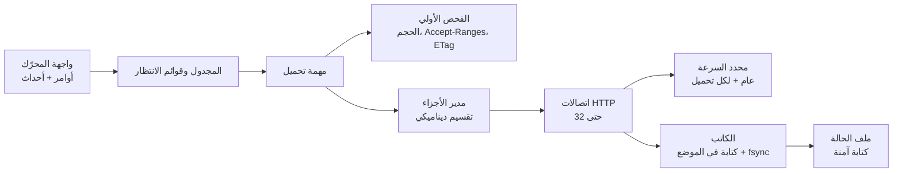
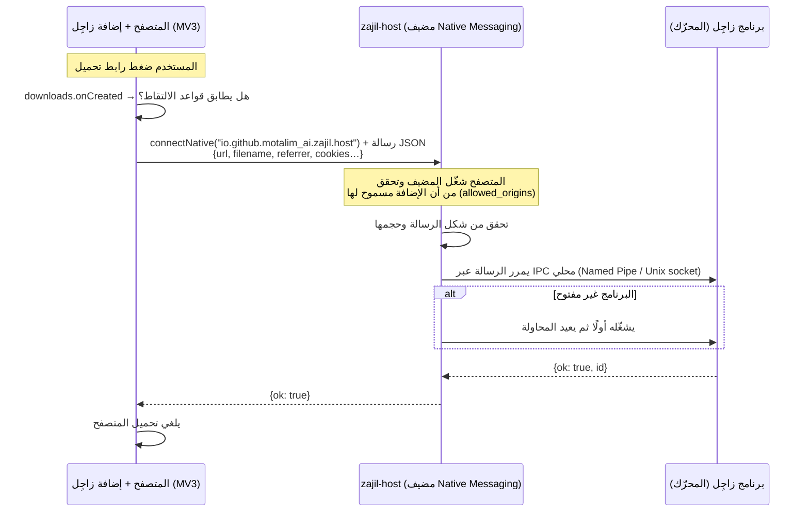

<div dir="rtl">

# بنية زاجِل (Architecture)

| البند | القيمة |
|---|---|
| الحالة | مسودة للموافقة (M0) |
| القرارات المرتبطة | [ADR-0003](adr/0003-language-and-ui-framework.md)، [ADR-0004](adr/0004-state-file-format.md)، [ADR-0005](adr/0005-extension-communication.md)، [ADR-0006](adr/0006-platform-abstraction.md) |

## 1. المبدأ: ثلاث طبقات، كل طبقة تعتمد على ما تحتها فقط



1. **المحرّك `zajil-core`**: مكتبة Rust لا تعرف شيئًا عن الواجهات. لا تطبع شيئًا على الشاشة، ولا تفتح نوافذ، ولا تقرأ إعدادات الواجهة. تستقبل أوامر (أضف، أوقف، استكمل…) وتُصدر **أحداثًا** (تقدّم، اكتمل، فشل…). ولهذا يمكن اختبارها بالكامل دون واجهة.
2. **سطر الأوامر `zajil`**: برنامج صغير فوق المحرّك. هو أول ما يُبنى (M1 إلى M3)، وهو أداة للمستخدمين المتقدمين وللاختبار.
3. **الواجهة الرسومية**: تطبيق Tauri فوق المحرّك (M4). لا تحتوي أي منطق تحميل، فهي تعرض الأحداث وترسل الأوامر فقط.

**قاعدة**: أي منطق يمكن أن يحتاجه أكثر من واجهة يوضع في المحرّك، وليس في الـ CLI أو الواجهة الرسومية.

## 2. خريطة المستودع (المخطط لها)

```text
zajil-download-manager/
├── crates/
│   ├── zajil-core/        # المحرّك (موجود الآن كمشروع فارغ)
│   ├── zajil-platform/    # واجهة الأنظمة + تنفيذ ويندوز/ماك/لينكس   (M1+)
│   ├── zajil-cli/         # الأمر zajil                              (M1)
│   ├── zajil-grab/        # الأنماط وتحميل الموقع، فوق المحرّك        (M7)
│   ├── zajil-host/        # مضيف Native Messaging الصغير              (M5)
│   ├── zajil-jsbox/       # صندوق QuickJS-NG ليوتيوب، يشغّله yt-dlp    (M6)
│   ├── zajil-i18n/        # الترجمات (Fluent) لجهة Rust               (M4)
│   └── zajil-testserver/  # سيرفر تجريبي للحالات الصعبة (للاختبار فقط) (M1)
├── apps/desktop/          # تطبيق Tauri: الواجهة (M4)
├── locales/               # ملفات الترجمة ar وen (Fluent)، للواجهة ولجهة Rust (M4)
├── extension/             # إضافة المتصفح MV3 لـ Chrome/Edge/Firefox (M5)
├── docs/                  # الوثائق والـ ADR
└── .github/               # الـ CI والقوالب
```

## 3. المحرّك من الداخل



### 3.1 دورة حياة التحميل
1. **الفحص**: طلب أولي يعرف الحجم (`Content-Length`)، وهل السيرفر يدعم `Accept-Ranges: bytes`، والـ `ETag` و`Last-Modified`، والاسم من `Content-Disposition`.
   - **صفحة ويب بدل الملف**: `Probe::content_type` نوع المحتوى، و`Probe::is_page()` تقول إن الرد صفحة ويب (`text/html` أو `application/xhtml+xml`)، فتحذّر الواجهة قبل التحميل.
   - **الامتداد من نوع المحتوى**: الاسم الذي لا امتداد له يأخذ امتداد نوعه من قائمة قصيرة للأنواع الشائعة (`text/html` يصير `.html`، `naming::with_type_extension`)، في الفحص والتحميل معًا. ولا نوع في القائمة امتداده لملف قد يشغّل برامج (`RUNS_CODE`)، فلا يصير `view` مثلًا `view.exe` بسبب ترويسة من السيرفر. وأي نقطة في الاسم تُحسب امتدادًا، فاسم مثل `v1.2` أو `John.Smith` جاء بـ `application/zip` يبقى كما هو بلا `.zip` (#152): مقبول، لأن الامتداد الموجود لا يتغير أبدًا.
   - **روابط Google Drive** (`crates/zajil-core/src/drive.rs`): صفحة الملف (`drive.google.com/file/d/<id>/view`، و`/open?id=`، و`/uc?id=`) تُطلب من عنوان التحميل (`drive.usercontent.google.com/download?id=<id>&export=download`). وصفحة التأكيد التي يرد بها Drive على الملفات الكبيرة تُقرأ (حتى 512 كيلوبايت) ويُؤخذ منها الرابط الحقيقي مرة واحدة. والرابط يُبنى من جديد على عنوان التحميل نفسه: نفس معرّف الملف، وفيه `confirm`، وقيمه حروف عادية فقط. وأي صفحة أخرى تأتي لعنوان التحميل، منه أو من حيث يحوّل (صفحة تسجيل الدخول لملف خاص، أو تجاوز حد التحميل، أو صفحة أكبر من الحد)، تُرفض بـ `Error::DrivePage`، ولا يُنشأ أي ملف. كل هذا في `Engine::get`، فيمر به الفحص والتحميل والاستكمال وتحديث الرابط. أما اتصالات التحميل المقسّم فتطلب الرابط النهائي مباشرة، فإذا رد Drive على أحدها بصفحة، يبدأ التحميل من جديد عبر `get` بدل أن تُكتب الصفحة في الملف. وملف الحالة يحفظ الرابط كما أعطاه المستخدم. **لا كوكيز** غير التي تأتي من الإضافة، وكل كوكيز لأصلها فقط، والمحرّك لا يحفظ أي كوكيز. ولأن رابط صفحة الملف يُحمَّل من عنوان التحميل، وهو أصل آخر من نفس الموقع، **يسأل زاجِل المتصفح عن كوكيز عنوان التحميل نفسه** (`zajil_core::drive::download_link`، وقرار المالك على روابط Drive): حين يأتي الرابط من الإضافة بكوكيز، وعند السؤال من جديد بعد إعادة التشغيل. والإضافة تجيب بما يرسله المتصفح نفسه لهذا العنوان (`cookies.getAll`)، ولا تنتقل أي كوكيز من موقع (registrable domain) إلى موقع آخر. وبلا إذن الكوكيز، الملف المشارَك مع المستخدم وحده يُرفض، ولا تُحفظ صفحة مكانه.
2. **التحضير**:
   - إذا كان الحجم معروفًا، يجب أن يتسع له المكان الحر في المجلد (`available_space`)، **قبل إنشاء أي ملف**. والحجم يأتي من السيرفر، فالحجم الضخم أو الكاذب يُرفض هنا برسالة واضحة (`NotEnoughSpace`). هذا هو الحد الأعلى لـ `Content-Length`.
   - يُنظَّف اسم الملف (القسم 6).
   - يُنشأ ملف جزئي `<الاسم>.zajil-part` في مجلد التحميل، ويُعطى حجمه بـ `zajil_platform::fs::allocate` (القسم 4).
   - يُنشأ ملف الحالة `<الاسم>.zajil-state` (ADR-0004).
3. **التحميل**:
   - **عدة اتصالات** (حتى 32، والافتراضي 8): فقط إذا أعلن السيرفر `Accept-Ranges: bytes`، وأعطى الحجم، ومُحقِّقًا قويًا. التفاصيل في القسم 3.2.
   - **اتصال واحد** في غير ذلك، أو إذا كان الملف أصغر من جزأين (الحد الأدنى للجزء 1 ميجابايت).
4. **الاستكمال** (`zajil resume <ملف-الحالة>`): يُقرأ ملف الحالة ويُتحقق منه، ويُقفل الملف الجزئي، ثم يُرسل `Range: bytes=<الموضع>-` مع `If-Range` حسب RFC 9110 §13.1.5 بالضبط: الـ `ETag` إن كان قويًا. ولا يُرسل `ETag` ضعيف (`W/`) أبدًا. ولا يُستخدم `Last-Modified` إلا إذا لم يوجد أي `ETag`، وكان «قويًا» (§8.8.2.2): قبل ترويسة `Date` في نفس الرد بثانية على الأقل، ولهذا تُحفظ `Date` في ملف الحالة. ويُطلب `final_url` أولًا، وإذا فشل (رابط CDN منتهٍ مثلًا) يُطلب الرابط الأصلي:
   - إذا رد السيرفر بـ `206`، ويبدأ `Content-Range` من موضعنا بالضبط، والحجم والـ `ETag` كما هما، يستمر التحميل من الموضع نفسه.
   - إذا رد بـ `200`، فالملف تغيّر على السيرفر أو السيرفر يتجاهل التقسيم: يُكتب الملف من البداية من هذا الرد نفسه. **لا خلط أبدًا.**
   - ويبدأ التحميل من جديد أيضًا إذا لم يوجد مُحقِّق قوي (لا يمكن كشف تغيّر الملف بأمان)، أو كان الملف الجزئي مفقودًا أو أقصر مما يقول ملف الحالة. والمحرّك يُصدر حدث `Restarted` بالسبب.
   - ملف الحالة الفاسد يُرفض قبل أي طلب، ولا يُلمس الملف الجزئي.
   - **ملف الحالة وما بجانبه مُدخلات غير موثوقة** (قد تأتي من جهاز آخر). لذلك: يُحوَّل المسار إلى مسار مطلق داخل المجلد الحقيقي، ويجب أن يكون الاسم نظيفًا (لا يغيّره `sanitize_file_name`)، ويُرفض أي `.zajil-state` أو `.zajil-part` يكون رابطًا رمزيًا أو رابطًا صلبًا أو غير ملف عادي، بفحص الملف **بعد فتحه** (`open_regular_nofollow`). و`.zajil-state.tmp` يُحذف ولا يُتبع أبدًا.
   - **تحديث الرابط** (M5، `Engine::refresh_link`، و`zajil resume <ملف-الحالة> --link <الرابط الجديد>`): رابط انتهى (رابط موقَّع مثلًا) يُستبدل برابط جديد **لنفس الملف**. تُقرأ ترويسات الرد الأول من الرابط الجديد فقط، ثم يُقبل إذا كان الحجم نفسه والمُحقِّق القوي نفسه (`ETag`، أو `Last-Modified` قوي) كما في ملف الحالة، فيُكتب الرابط في ملف الحالة ويكمل الاستكمال من حيث توقف. **وإلا يُرفض** (`NotTheSameFile`) ولا يتغير ملف الحالة: لا حجم معروف، أو حجم آخر، أو مُحقِّق آخر، أو لا مُحقِّق قوي أصلًا (فلا يمكن معرفة أنه نفس الملف). ورابط فيه اسم مستخدم أو كلمة مرور يُرفض، والرابط النهائي بعد التحويلات يُحفظ بلا اسم مستخدم ولا كلمة مرور، كما في أي تحميل. وتحميل يعمل لا يُغيَّر: قفل الملف الجزئي يُمسك من قبل قراءة ملف الحالة إلى بعد كتابته، وإن لم يوجد ملف جزئي يُنشأ فارغًا ليُمسك قفله (فيبدأ الاستكمال من جديد كما كان سيفعل)، ويُحذف إن فشل التحديث. **وسيرفر يكذب** (نفس الحجم والمُحقِّق لمحتوى آخر) لا يُكشف بلا بصمة للملف، كما في أي استكمال. والفحص طلب GET عادي يُقطع بعد الترويسات، فقد يرسل السيرفر قليلًا من الملف قبل القطع. والرابط الجديد يُكتب في ملف الحالة كما يكتبه محلل الروابط (كرابط أي تحميل وأي عنصر في القوائم)، فتظل القوائم تستكمل ملف الحالة لعنصره.
   - **في البرنامج** (أمر `refresh_link`، وزر «تحديث الرابط» في التفاصيل): لتحميل متوقف مؤقتًا أو فاشل فقط (تحميل يعمل أو ينتظر دوره يُطلب إيقافه أولًا، والمكتمل لا يحتاج). مع ملف حالة: فحص المحرك أعلاه، مع كوكيز المتصفح وصفحته المحفوظة لهذا التحميل؛ وبلا ملف حالة (لم يبدأ بعد) يأخذ الرابط الجديد فقط. ثم يأخذ العنصر الرابط الجديد وينتظر دوره ليكمل. وسبب الرفض يصل نوعًا محددًا (`RefreshProblem`: حجم آخر بالحجمين، نسخة أخرى، لا مُحقِّق…) فتقوله النافذة بلغة المستخدم. وتحميل يُحدَّث رابطه لا يُستأنف في أثناء ذلك، حتى لا يبدأ من الرابط القديم أو من جديد.
   - **ترويسات المتصفح** (M5، `FromBrowser` و`Engine::with_browser`): كوكيز المتصفح للرابط، والصفحة التي جاء منها (`Referer`)، **في الذاكرة فقط**، ولا تُكتب في ملف الحالة أبدًا (قرار المالك على #7). والكوكيز تُرسل فقط إلى نفس الأصل (البروتوكول والمضيف والمنفذ) الذي أُعطيت له: لا إلى CDN يحوّل إليه السيرفر، ولا إلى عنوان آخر تُطلب منه الأجزاء. ولا تظهر في أي رسالة أو سجل. أما الصفحة (`Referer`) فبقاعدة المتصفحات الافتراضية (`strict-origin-when-cross-origin`): العنوان كاملًا إلى أصله، وأصله وحده (`https://الموقع/`) إلى أصل آخر، ولا شيء من https إلى http. **ولا `Referer` من عند المحرّك نفسه** (مراجعة #74): مكتبة reqwest كانت ترسل بعد كل تحويل الرابط المحوِّل، ومعه رمز `?sig=…`، إلى الهدف.
   - **الكوكيز الصارمة** (`SameSite=Strict`) لتحميل تلتقطه الإضافة تذهب كما يرسلها المتصفح: فقط إن كانت الصفحة التي جاء منها التحميل (`referrer`) من نفس الموقع، وبلا صفحة يُعرف بها لا تذهب، ولا حين يطلب زاجِل الكوكيز من جديد بعد إعادة التشغيل (#92، قرار المالك).
5. **الاسم**: لا يُكتب فوق ملف موجود أبدًا. إذا كان الاسم مستخدمًا (الملف النهائي أو ملف جزئي أو ملف حالة)، يُجرَّب `الاسم (1).امتداد` ثم `(2)`… (ويُقصَّر الجزء الأساسي من الاسم قبل إضافة الرقم، فلا يتجاوز الاسم 200 بايت أبدًا) والملف الجزئي يُنشأ بـ `create_new` ويُقفل طوال التحميل. وعند الإنهاء تُستخدم إعادة تسمية لا تستبدل أبدًا (`zajil_platform::fs::rename_noreplace`)، فإذا ظهر ملف بنفس الاسم أثناء التحميل، يأخذ الملف المكتمل اسمًا مرقّمًا.
   - **أقراص بلا روابط صلبة** (قرار المالك، M2): بعض أنظمة الملفات ترفض إعادة التسمية دون استبدال، **وترفض أيضًا** البديل (رابط صلب ثم حذف). مثال مختبر: exFAT في ماك. في هذه الحالة فقط يُفحص الاسم، ثم تُستخدم إعادة تسمية عادية (`check_then_rename`). وعلى كل الأقراص الأخرى تبقى الطريقة الأصلية.
   - **نافذة السباق**: إذا أنشأ برنامج آخر ملفًا بنفس الاسم في اللحظة بين الفحص وإعادة التسمية، فإنه يُستبدل. أما تحميلات زاجِل نفسها فلا تتسابق هنا، لأن كل تحميل يعيد التسمية إلى اسم يملك ملفه `.zajil-part`، أو إلى اسم حر لم يحجزه أحد.
   - **مختبر في الـ CI** على صور أقراص FAT32 وexFAT على الأنظمة الثلاثة. في لينكس يُركَّب exFAT عبر برنامج FUSE إذا لم تكن وحدة النواة موجودة في جهاز الـ CI، وهذا ما وجدناه حتى الآن. أما برنامج النواة نفسه وSMB فيُختبران يدويًا ([MANUAL-TESTS](MANUAL-TESTS.md)).
   - **إلغاء تحميل جديد قبل أول بايت** يزيل ملفيه ليتحرر الاسم. ولا يُمسحان في مكانهما، بل يُفرَّغ الـ part، ويُنقل الملفان أولًا إلى اسم فريد يبدأ بنقطة في نفس المجلد (`.zajil-removed-<العملية>-<رقم>`، مخفي في ماك ولينكس لا في ويندوز؛ `zajil_platform::fs::move_aside`)، والقفل ما زال قائمًا. ثم يُقفل الـ handle، ثم يُمسح المنقول. السبب: في ويندوز، الملف الممسوح وعليه handle مفتوح (لنا، أو لمضاد فيروسات) يبقى «delete pending» ويبقى اسمه محجوزًا حتى يُقفل آخر handle. وهذا دائم في FAT32 وexFAT ومشاركات الشبكة، ولحظي في NTFS. فكان تحميل يُضاف فورًا بنفس الاسم يفشل بـ os error 5 (#55).
6. **الإنهاء**: يُتحقق من الحجم (ومن البصمة إن كانت معروفة)، ثم يُعاد تسمية الملف الجزئي إلى اسمه النهائي **في خطوة واحدة**، ثم يُحذف ملف الحالة.

### 3.2 التقسيم (M2)

**المطبَّق الآن** (`crates/zajil-core/src/segmented.rs`):
- **الأجزاء**: يُقسم الملف إلى أجزاء متصلة ومتساوية، بعدد الاتصالات، ولا يقل الجزء عن 1 ميجابايت. والأجزاء تُحفظ في ملف الحالة (`segments`).
- **الاتصال الأول**: هو رد الفحص الأول نفسه (`200` بالملف كاملًا)، فلا يضيع. وكل اتصال آخر يطلب جزءه بـ `Range: bytes=a-b` مع `If-Range`.
- **قبول الرد**: يُقبل الرد فقط إذا كان `206` و`Content-Range` هو الجزء المطلوب بالضبط، لملف بنفس الحجم ونفس النسخة.
  - إذا رد السيرفر بـ `200` وتغيّر الملف: يتوقف كل شيء، ويبدأ التحميل من جديد من هذا الرد (حدث `Restarted` بالسبب `FileChanged`). ولا تُخلط النسختان أبدًا.
  - إذا رد بـ `200` ولم يتغيّر الملف (السيرفر يتجاهل التقسيم): لا تُرسل طلبات تقسيم أخرى، والاتصال الأول يكمل.
- **من يكتب ماذا**: كل اتصال يملك جزءًا واحدًا في كل لحظة، ويكتب في موضعه عبر الـ handle المقفول (`write_at`). ويحجز البايتات قبل أن يكتبها. ولا يأخذ اتصال جزءًا فيه بايت مكتوب أو محجوز.
- **الاتصال الذي ينهي جزءه** يكمل في الجزء التالي إذا لم يُكتب فيه شيء بعد. هكذا يُقرأ سيرفر يتجاهل التقسيم حتى النهاية على اتصال واحد. وإلا يأخذ أول جزء حر.
- **الحفظ**: يُنسخ الوضع، ثم `sync_data`، ثم يُحفظ المنسوخ. فملف الحالة لا يعدّ أبدًا بايتات لم تُثبَّت على القرص.
- **الاستكمال**: أول جزء ناقص يُطلب أولًا، مع الرجوع إلى الرابط الأصلي إذا فشل `final_url`، ويُفحص كما في M1. ثم يأخذ كل اتصال جزءًا ناقصًا من أول بايت ينقصه.
- **إعادة استخدام الاتصالات**: عبر مجمّع `reqwest` (keep-alive). مختبر: ثمانية أجزاء على اتصالين.
- **اسم المستخدم وكلمة المرور في الرابط** (`user:pass@`): يُرسلان مع كل طلب جزء، لكن فقط إذا كان الرابط النهائي على نفس المصدر (origin)، كما يفعل `reqwest` في التحويلات. ويبقيان في الذاكرة فقط، ولا يُكتبان في ملف الحالة. مختبر: سيرفر يشترط `Authorization` على كل طلب، وتحويل إلى سيرفر آخر لا يصله شيء منهما. ولهذا لا يملكهما الاستكمال من ملف الحالة.
- **ملف «يتغير» أثناء التقسيم**: بعض السيرفرات وراءها عدة أجهزة، ولكل جهاز `ETag` مختلف للملف نفسه. فإذا ظهر تغيّر بعد بدء التقسيم، يبدأ التحميل من جديد **على اتصال واحد**، من الرد الذي أظهر التغيّر. واتصال واحد يبقى على جهاز واحد. مختبر بسيرفر يتبدل `ETag` فيه حسب الاتصال (وجدته مراجعة #24).

**التقسيم الديناميكي**:
- **متى**: عندما لا يجد اتصال جزءًا حرًا.
- **أي جزء**: يختار الجزء الذي يحتاج **أطول وقت متبقٍّ**، أي ما بقي منه (لم يُكتب ولم يُحجز) ÷ سرعة اتصاله منذ أخذه.
  - لا يُحكم على اتصال قبل نصف ثانية من العمل.
  - الاتصال الذي لم يرسل شيئًا لمدة ثانية يُعد متوقفًا، فيُقسم جزؤه أولًا.
- **التقسيم**: يُقسم ما بقي نصفين، ويأخذ الاتصال الحر النصف الثاني بطلب `Range` جديد، ويتوقف الاتصال القديم عند بداية الجزء الجديد.
- **الحد الأدنى**: لا يُقسم جزء إذا كان نصف ما بقي منه أقل من الحد الأدنى للجزء (1 ميجابايت افتراضيًا)، حتى لا نضيّع الوقت في فتح اتصالات لا داعي لها.
- **الانتظار**: إذا كانت كل الاتصالات أحدث من أن يُحكم عليها، ينتظر الاتصال الحر قليلًا ثم ينظر مرة أخرى. وإذا لم يبقَ ما يستحق التقسيم، ينتهي.
- **التسجيل**: كل تقسيم يُعلن بحدث `Event::Split { segment, at }`، ويُحفظ في ملف الحالة مع الحفظ التالي، فيمكن الاستكمال بعده.
- **ملاحظة للواجهات**: إلغاء التحميل بإسقاط الـ future يوقف الاتصالات، لكن الملف الجزئي يبقى مقفولًا لحظات، حتى تنتهي مهامها وكتاباتها الجارية. هذا مقصود: تحرير القفل قبل ذلك قد يسمح لكتابة متأخرة أن تقع في ملف بدأ من جديد. والاستكمال الفوري في نفس العملية قد يرى `Locked`. وطريقة «أوقف وانتظر» (`Stop`) جاءت مع القوائم في M3 (القسم 3.3): لا تعود إلا بعد أن يتوقف كل شيء.

**إعادة المحاولة والسيرفر المشغول** (`crates/zajil-core/src/retry.rs`):
- **الأعطال المؤقتة**: إذا انقطع اتصال، أو انتهت مهلته، أو رد السيرفر بـ `5xx` أو `408`، يعود جزؤه إلى الطابور بعد انتظار.
  - الانتظار يتضاعف: نصف ثانية، ثم ثانية، ثم ثانيتان…، وأقصاه 30 ثانية.
  - فيه عنصر عشوائي: بين نصف السقف والسقف (equal jitter)، حتى لا تعود الاتصالات كلها في اللحظة نفسها.
  - الاستكمال من أول بايت ناقص في الجزء، لا من بدايته.
- **الاستسلام**: بعد 5 أعطال متتالية دون كتابة أي بايت بينها، يُترك الجزء، فيتوقف التحميل قابلًا للاستكمال برسالة فيها السبب.
- **429**:
  - لا يُرسل أي طلب إلى السيرفر قبل انتهاء `Retry-After` (بالثواني أو بتاريخ HTTP). وإذا لم يوجد، يُستخدم الانتظار المتضاعف.
  - إذا طلب السيرفر أكثر من 10 دقائق، لا ننتظر: يتوقف التحميل قابلًا للاستكمال.
- **403 أو 429 بينما تعمل اتصالات أخرى**: معناه أن السيرفر يحدد عدد الاتصالات. فينخفض الحد إلى عدد الاتصالات التي قبلها، ولا يرتفع مرة أخرى في هذا التحميل. ويعود الجزء إلى الاتصالات الباقية. أما 403 على الاتصال الوحيد فهو رفض حقيقي، فيُترك الجزء.
- **التسجيل**: كل ذلك يُعلن بحدث `Event::ServerBusy { status, connections, wait }`.
- **حد كل موقع** (`sites.rs`، قرار المالك في 2026-10-26): لا حد افتراضيًا. والمواقع التي يضعها المستخدم في `site_connections` (ملف الإعدادات) لكلٍّ منها عدّاد واحد مشترك بين كل تحميلاته (`Engine::with_site_limits`):
  - كل تحميل يأخذ مكانًا واحدًا قبل أول طلب (أو بعد قراءة ملف الحالة في الاستكمال، ثم يقرؤه مرة ثانية بعد الانتظار، ثم يقفل الملف الجزئي)، ويبقى معه حتى ينتهي. وإذا لم يجد مكانًا ينتظر، وطلب الإيقاف ينهي الانتظار.
  - وكل اتصال إضافي في التحميل المقسَّم يحتاج مكانًا آخر. فإن لم يجده، ينتظر ربع ثانية ثم ينظر مرة أخرى، لأن تحميلًا آخر قد يعيد مكانًا. ولا يُمسك مكانًا وهو ينتظر أي شيء.
  - فلا يزيد عدد الاتصالات بالموقع على حده، مهما كان عدد التحميلات. والتخفيض التلقائي مع 429 و403 يبقى كما هو داخل كل تحميل.
  - **في الطوابير** (#170): المشغّل لا يبدأ من تحميلاته على موقع أكثر من حده (`Engine::site_room` يعطي الموقع وحده). فالذي كان سينتظر يبقى في الانتظار، ولا يأخذ مكانًا في طابوره، ويبدأ الذي بعده. والعدّ هو تحميلات المشغّل نفسه على الموقع (الجارية، وما بدأه في النظرة نفسها)، لا الاتصالات الفارغة: الاتصالات الإضافية لتحميل مقسَّم لا تمنع التحميل التالي، الذي ينتظر مكانه الأول وتعطيه الإشارة قبلها (مراجعة #170). ويُصدر `QueueEvent::WaitingForSite` مرة واحدة لكل انتظار، فتظهر حالته في الجدول «ينتظر الموقع». مختبر: `a_download_waiting_for_its_site_takes_no_place_in_its_queue`، والسيرفر يعدّ ما يرسله على الموقع في الوقت نفسه.
  - **تغيير القائمة وهي تعمل** (#165، و#170 البند 2): `SiteLimits::set` يغيّرها في مكانها، فيراها المحرّك وكل نسخه، ومنها نسخة مشغّل الطوابير الجارية. والموقع الباقي يحتفظ بعدّاده، فتُعدّ التحميلات الجارية والجديدة معًا، بلا عدّاد ثانٍ. والحد الأعلى يعطي أماكنه فورًا. والأدنى يأخذ الفارغة فورًا، والمشغولة حين تعيدها التحميلات. لكن تحميلًا ينتظر موقعه قد يأخذ مكانًا عائدًا قبلها، فقد يزيد عدد الاتصالات على الحد الجديد لوقت قصير، حتى تعود أماكن كافية (مراجعة #165). والموقع المحذوف من القائمة لا حد لتحميلاته الجديدة، وما ينتظر منها يبقى على عدّاده القديم. والتطبيق يقرأ القائمة عند البدء، ويطبّقها فور حفظها من الإعدادات.
  - ما لا يُحسب: طلبات الفحص وقراءة الصفحات القصيرة، وأول طلب عند تحديث رابط. والموقع هو عنوان التحميل كما أُعطي، لا العنوان الذي يحوّل إليه.
- **ملاحظة**: السيرفر قد يعدّ لحظات اتصالًا أغلقناه للتو، فيرفض طلبًا جديدًا ونحن ضمن حده. حينها ينخفض الحد واحدًا إضافيًا. هذا حذر مقبول، والتحميل يكتمل.
- **الطلب الأول والاتصال الواحد (M3)**، بقرار المالك على #28، وبنفس السياسة:
  - كل طلب (الطلب الأول، وطلبات الاستكمال والبدء من جديد) يُعاد إذا فشل لسبب قد يزول: اتصال لم يُفتح أو انقطع، أو مهلة انتهت، أو `5xx` أو `408` أو `429`.
  - **لا يُعاد أبدًا**: شهادة غير موثوقة، أو تحويل مرفوض، أو أي رد آخر مثل `403` و`404`.
  - و`429` ينتظر `Retry-After`، فإذا طلب أكثر من 10 دقائق لا ننتظر (`Error::ServerBusy`).
  - **التحميل باتصال واحد إذا انقطع**: يُحفظ ما على القرص أولًا، ثم يُطلب الباقي بـ `Range` و`If-Range`. وإذا لم يستطع السيرفر أن يكمل من هناك (لا مُحقِّق قوي، أو تجاهل التقسيم، أو تغيّر الملف)، يبدأ التحميل من البايت 0 من الرد الكامل نفسه، بحدث `Restarted`. **لا خلط أبدًا.**
  - **التقدم** يعني تجاوز أبعد بايت وصل إليه التحميل في هذه المحاولة. فالسيرفر الذي لا يكمل من المنتصف وينقطع دائمًا في نفس الموضع يُترك بعد 5 مرات، ولا يُعاد إلى ما لا نهاية.
  - كل إعادة تُعلن بحدث `Event::Retrying { wait, reason }`، والسبب لا يحتوي التوكن ولا بيانات الدخول.
  - العدد قابل للتغيير: `Options::max_failures`، و`zajil --tries`. والقيمة 1 تعني بلا إعادة.
- **تغيّر الملف أثناء التقسيم** (قرار المالك على #28): الإكمال على اتصال واحد مقبول. والاختبار `a_change_during_splitting_leaves_only_the_new_version` يثبت أن الملف النهائي هو النسخة الجديدة كاملة، دون أي بايت من القديمة، مع أن أغلب القديمة كانت على القرص.

### 3.3 القوائم (M3)

**المطبَّق** (`crates/zajil-core/src/queue/`، [ADR-0007](adr/0007-queues-and-settings-storage.md)، [QUEUES-FILE](QUEUES-FILE.md)):
- **القوائم والإعدادات** في ملف واحد، `queues.json`، في مجلد البيانات. والتعديل يمر دائمًا عبر `QueueStore::update` بقفل بين العمليات.
- **المشغّل** (`Runner`، و`zajil queue run`):
  - يبدأ التحميلات المنتظرة بالترتيب، ولا يتجاوز `max_active` لكل قائمة.
  - يقرأ الملف عند كل تغيير، ومرتين في الثانية ليرى تعديلات العمليات الأخرى.
  - نسخة واحدة فقط تعمل (`runner.lock`).
  - **المحاولات لكل ملف** (#142، `queues[].max_tries` من 1 إلى 100، و1 بدونه): التحميل الذي يفشل بخطأ قد يزول (انقطاع، أو شبكة، أو 5xx من السيرفر) وبقيت له محاولات، يعود إلى الانتظار في **آخر قائمته**، ولا يبدأ قبل انتظار يتزايد مع محاولاته (`retry::backoff`)، ويُصدر `QueueEvent::Retrying`. وما لا يزول بالإعادة (404 و403، والشهادة المرفوضة، والقرص الممتلئ، و`ServerBusy`) يفشل من أول مرة كما قبل. ولا يُعد فشلًا (`Summary.failed` و`QueueEvent::Failed`) إلا آخر محاولة. والعدّاد `items[].failed_tries` يعود إلى 0 حين يكتمل أو يبدؤه المستخدم. وتحميل النافذة الخاصة لا يُعاد، لأنه يُؤخذ من القوائم عند أول فشل.
  - **«انتهى الطابور»** (`QueueEvent::QueueDone`، #142): حين تكتمل كل تحميلات قائمة، ويكون أحدها قد اكتمل منذ آخر نظرة، أي باكتمال تحميل لا بتعديل. يُقال مرة واحدة حتى يصير فيها عمل من جديد. وقائمة كل تحميلاتها من نافذة خاصة لا تنتهي هكذا أبدًا، لأنها تُؤخذ من القوائم.
  - **الملف أو البرنامج بعد الطابور** (`queues[].after_open`، #142): مسار مطلق يختاره المستخدم. التطبيق نفسه يعرض نافذة الاختيار ثم يطلب التأكيد مع المسار (`choose_after_open`)، والصفحة لا ترسل مسارًا. ويفتحه التطبيق عند «انتهى الطابور» بطريقة النظام في الفتح (`tauri-plugin-opener`: ShellExecute في ويندوز، و`open` في ماك، و`xdg-open` في لينكس)، بلا shell ولا معاملات. ويُقبل الملف، وتطبيق ماك (`.app`، وهو مجلد). وفي لينكس، `xdg-open` يفتح الملفات ومشغّلات `.desktop`، أما البرنامج الثنائي نفسه فلا يُشغَّل عادةً. ولا يأتي هذا الحقل من استيراد ولا من الشبكة، ولا يُصدَّر.
- **«أوقف وانتظر»** (`Stop`، و`Engine::download_until` و`resume_until`):
  - عند الطلب يتوقف الاستقبال، وتنتهي كل الاتصالات، ويُثبَّت ما على القرص ويُسجَّل، **إلا إن كان حفظ دوري قد نجح** (بقرار المالك على #132): ملف الحالة يعدّ ما زُومِن فقط، فلا حاجة لحفظ ثانٍ قد يأخذ ثوانيَ على قرص بطيء، ويُعاد تنزيل نحو ثانية من التقدم عند الاستكمال.
  - **ثم فقط** تعود الدالة بـ `Error::Stopped`: لا كتابة ولا حفظ يعمل بعدها، والملف الجزئي مغلق وغير مقفول.
  - فالاستئناف الفوري في نفس العملية آمن، ولا يكتب حفظ قديم فوق حالة أحدث (الملاحظة المؤجلة في #5).
  - أما إسقاط الـ future فما زال يوقف التحميل كما في M2، لكن آخر الحفظات قد تنتهي بعده.
- **المشغّل الذي قُتل** يترك تحميلات بحالة `active`، فتعود إلى `waiting` في التشغيل التالي، وتُستكمل من ملفات حالتها.

**حد السرعة** (`crates/zajil-core/src/limit.rs`):
- **حدان**: حد للبرنامج كله (`zajil queue speed-limit`، في `settings.speed_limit` في ملف القوائم)، وحد لكل تحميل (`zajil get --limit`، و`zajil queue add --limit`). وتغيير حد البرنامج يصل إلى التحميلات الجارية خلال نصف ثانية. وكذلك حد التحميل نفسه (`limit` في ملف القوائم، من تبويب «حد السرعة» في نافذة التقدم): المشغّل يقرؤه عند كل نظرة، ويعطيه للتحميل الجاري عبر مقبض الحد الخاص به (`Engine::with_own_limit`)، دون أن يتوقف التحميل (#106).
- **الطريقة**: دلو رموز (token bucket) يمر به كل اتصال.
  - الاتصال يأخذ من الدلو **كل قطعة فور وصولها**، ثم ينتظر قبل أن يقرأ المزيد. والدلو قد يدخل في دَين، فينتظر كل اتصال دوره في سداده. وكان يأخذ بعد كتابة دفعة كاملة (256 كيلوبايت)، فكانت أول دفعة من كل اتصال تمر بالسرعة الكاملة (مراجعة #32: من 3 إلى 6 أضعاف الحد في الثانية الأولى). ومختبر الآن أن المكتوب لا يتقدم على الحد في أي لحظة.
  - **تغيير الحد** (أو إزالته) يوقظ الاتصالات المنتظرة، فتنتظر بالمعدّل الجديد (مراجعة #32: كانت تنتظر بالمعدّل القديم حتى دقائق).
  - **الرصيد المدخر محدود** بعُشر ثانية من الحد، فلا تأتي دفعة كبيرة بعد توقف.
  - تقليل القراءة يجعل TCP يبطئ السيرفر، فيصح الحد على الشبكة أيضًا.
- **حدّان معًا**: يُحجز من الاثنين أولًا، ثم ينتظر الاتصال حتى أبعد الموعدين. الانتظار عند أحدهما ثم الآخر كان يجمع الانتظارين، فتصير السرعة أقل من أصغر الحدين (0.83 منه، وجده اختبار).
- **ما يُحسب**: كل قطعة تصل. وما يرميه الاتصال بعد ذلك دون أن يكتبه (ما قرأه بعد نهاية جزئه) **يُرَدّ إلى الدلو رصيدًا** تستعمله القراءات التالية. لذلك يصل الملف بسرعة الحد في المتوسط، وقد تحمل الشبكة أكثر منه. ولتقليل هذا الهدر، يكتب الاتصال فورًا عندما يتجاوز نهاية جزئه، فيعرف هل يكمل في الجزء التالي. **وما دام حد فعّالًا، يكتب كل قطعة فور وصولها** بدل دفعات 256 كيلوبايت: الدفعة التي يتركها التقسيم كانت تُرمى، وقرب نهاية التحميل لا تبقى قراءة تستعمل رصيدها (قاس الـ CI مرة 0.89 من الحد. وبعد الإصلاح كانت أدنى نسبة 0.96، تحت حمل ست نسخ متوازية). **ما لم يُحل بعد**: الطلب الأول مفتوح النهاية، فالسيرفر قد يرسل أكثر مما يقرؤه الاتصال (مراجعة #32، مؤجل).
- **الساعة** (`Clock`): الحقيقية في البرنامج، و`ManualClock` في الاختبارات: لا تتحرك إلا عندما يجعل الحد تحميلًا ينتظر، فالوقت الذي تعرضه هو بالضبط ما كلّفه الحد، مهما كانت سرعة الجهاز. لم نستعمل `tokio::time::pause`، لأنه يقدّم الوقت أيضًا لمهلات الاتصال الحقيقية بينما ننتظر الشبكة.
- **بالساعة الحقيقية**: اختبار واحد في كل PR (`the_real_clock_drives_limits_and_schedules`). واختبار ثانٍ للثانية الأولى من الحد (`speed_limit_real_clock.rs`) يعمل كل ليلة فقط، بقرار المالك على #36، البند 14 (وانظر القسم 8 هنا).

**فحص التحديث** (`crates/zajil-core/src/update.rs`، #124، بقرار المالك): طلب واحد بالمحرّك نفسه إلى قائمة إصدارات زاجِل على GitHub (لا `/releases/latest`، لأنه يترك الإصدارات التجريبية، وكل 0.x تجريبي)، ويُقرأ منه 1 ميجابايت على الأكثر. ولا يُحسب إلا وسم `vX.Y.Z` ليس مسودة. وصفحة الإصدار يبنيها زاجِل على `RELEASE_PAGES`، ولا يأخذ أي رابط من الرد. والتطبيق يسأل مرة عند البدء في الخلفية إن كان `update_check` مفعّلًا، ولا يسأل في نسخ التطوير. والخطأ سطر في السجل فقط. ولا تنزيل ولا تثبيت أبدًا.

**الجدولة** (`crates/zajil-core/src/queue/schedule.rs`):
- **نافذة لكل قائمة** كل يوم، بالتوقيت المحلي: من `start` (00:00 إن لم يُحدد) إلى `stop` (منتصف الليل إن لم يُحدد). وإذا لم تكن `stop` بعد `start`، تنتهي النافذة في اليوم التالي. و`days` تحدد الأيام التي تبدأ فيها النافذة.
- **التوقيت المحلي** من منطقة النظام الزمنية مع قواعد التوقيت الصيفي (مكتبة `jiff`). البداية التي تقع في ساعة محذوفة تحدث بعدها مباشرة، وفي الساعة المكررة تحدث أول مرة. مختبر بمنطقة نيويورك.
- **المشغّل**:
  - خارج النافذة لا يبدأ شيئًا من القائمة، ويوقف تحميلاتها الجارية بطريقة «أوقف وانتظر»، فتعود إلى الانتظار.
  - ينام حتى أقرب تغيير في أي نافذة (على ساعة المحرّك)، ويُصدر `QueueEvent::Waiting { queue, until }`.
  - ولا ينتهي ما دام في قائمة مجدولة تحميل ينتظر.
  - **«ابدأ الآن»** (`Runner::run_now`، #125): قائمة يبدؤها المستخدم الآن تُعامل كأن نافذتها مفتوحة، حتى لا يبقى فيها ما ينتظر أو يعمل، أو تُحذف، أو يُزال جدولها. وجدولها المحفوظ لا يتغير. والمجموعة في الذاكرة فقط، والتطبيق لا يضيف إليها إلا قائمة لها جدول وفيها ما يعمل، بعد أن تصير تحميلاتها في الانتظار.
- **الساعة في الاختبارات**: `ManualClock::frozen`، لا تتحرك إلا عندما يقدّمها الاختبار. فـ«الساعة الآن 23:00» دقيقة ولا تعتمد على سرعة الجهاز.

### 3.4 ضمان سلامة البيانات
البيانات تُكتب في الملف الجزئي **وتُثبَّت على القرص (fsync) قبل** أن يسجل ملف الحالة أنها اكتملت. لذلك:
- إذا انقطعت الكهرباء، فأسوأ ما يحدث أن نعيد تحميل جزء صغير.
- ولن نعتبر أبدًا بيانات ناقصة أو فاسدة مكتملة.

**ما اختُبر فعلًا**: قطع الاتصال، وإيقاف العملية بالقوة (kill). أما انقطاع الكهرباء الحقيقي فلم يُختبر على أي نظام، لأن قتل العملية يُبقي ذاكرة النظام المؤقتة. وفي ويندوز تعتمد إعادة التسمية على `MOVEFILE_WRITE_THROUGH` بدل `fsync` للمجلد.

### 3.5 الفئات (M4)

**المطبَّق** (`crates/zajil-core/src/category.rs`، [CATEGORIES-FILE](CATEGORIES-FILE.md)):
- **ملف منفصل** `categories.json` بجانب `queues.json`، بقرار المالك: الفئات إعدادات يعدّلها المستخدم، والقوائم حالة عمل. وبنفس قواعده: البصمة، والقراءة الصارمة، والكتابة الآمنة، والقفل.
- **الفئة**: أول فئة فيها موقع يطابق مضيف الرابط النهائي، ثم أول فئة فيها امتداد الملف، وإلا لا فئة.
- **علامة «من الإنترنت» على كل ملف مكتمل** (`zajil_platform::origin`، مراجعة الأمان #84)، كما تفعل المتصفحات، فيحذّر النظام قبل تشغيل برنامج منه (SmartScreen وGatekeeper)، ويفتح Office المستند في العرض المحمي ويوقف الماكرو: تُكتب على الملف الجزئي قبل أن يأخذ اسمه، فلا يوجد الملف باسمه بلاها لحظة (مراجعة #90): في ويندوز مجرى `Zone.Identifier` بـ `ZoneId=3` و`HostUrl` **أصل الرابط وحده** (بلا المسار ولا التوكن)، وفي ماك `com.apple.quarantine`، وفي لينكس `user.xdg.origin.url` بالأصل وحده. ونظام ملفات لا يحملها (FAT32 وexFAT) يبقي الملف بلاها.
- **المجلد يُختار بعد أن يرد السيرفر** وقبل إنشاء أي ملف (`Engine::download_choosing_until`)، لأن الاسم قد يأتي من `Content-Disposition`. والقوائم تعرف التحميل الذي يذهب بالفئة من `items[].categorize`.
- **الفئات المدمجة بلا مجلدات** حتى يختار المستخدم، فلا تظهر مجلدات لم يطلبها.

### 3.6 الترجمة (M4)

- **ملف واحد لكل لغة**: `locales/ar/zajil.ftl` و`locales/en/zajil.ftl`، بنظام Fluent (ADR-0003). تقرؤه الواجهة بـ `@fluent/bundle` (ADR-0008)، وجهة Rust بـ `zajil-i18n`، وهي لقائمة شريط النظام والإشعارات. وسطر الأوامر يبقى بالإنجليزية (قرار المالك).
- **صيغ الجمع العربية الست** تُختار دائمًا بالدالة `PLURAL($count)`، وهي تعيد اسم فئة CLDR: في Rust من ICU4X (`icu_plurals`)، وفي الواجهة من `Intl.PluralRules`.
  - **لماذا لا يُختار بـ `$count` مباشرة**: قواعد الجمع داخل `fluent-bundle` (المكتبة `intl_pluralrules` 7.0.2) تعطي 103 و111 بالعربية الفئة «other»، والصحيح «few» و«many». وجدته اختبارات `zajil-i18n`.
  - واختبار يرفض أي رسالة تختار بالمتغير نفسه.
- **العزل**: القيم داخل الجملة تُحاط بعلامتي العزل U+2068 وU+2069، فيبقى اسم الملف اللاتيني باتجاهه داخل الجملة العربية.

### 3.7 الواجهة (M4)

**المطبَّق** (`apps/desktop`، [ADR-0008](adr/0008-ui-library.md)):
- **Tauri 2 فوق المحرّك**، بلا أي منطق تحميل (القسم 1). جهة Rust (`src-tauri/src/lib.rs`):
  - **تشغّل القوائم** بـ `Runner` طوال فتح النافذة: إذا انتهى لأن لا شيء بقي، يعود عندما يظهر تحميل منتظر.
  - **أوامر الواجهة** تمر عبر ملف القوائم نفسه، كما في `zajil queue`: الإضافة، والإيقاف المؤقت، والاستكمال، والحذف.
  - **الفحص قبل الإضافة** (أمر `probe`): يرفض أولًا ما سترفضه الإضافة (`queue::check_url`). ثم `Engine::probe_until` يقرأ ترويسات الرد الأول فقط، فيعرف الاسم والحجم وهل يمكن الاستكمال ولماذا لا، ثم الفئة وما اختارها (موقع أو امتداد) والمجلد من `categories.json`. وإقفال الحوار يوقفه (`cancel_probe`).
  - **الإعدادات** (`docs/SETTINGS-FILE.md`): اللغة والمظهر والأرقام تتغير فورًا دون إعادة تشغيل. ومعها مجلد التحميل، وعدد الاتصالات للتحميل التالي، وحد السرعة العام (في `queues.json`)، وتصدير القوائم واستيرادها. ونوافذ الفتح والحفظ يعرضها النظام نفسه (`tauri-plugin-dialog`)، والصفحة لا تقرأ ملفات ولا تكتبها بنفسها: تمرر المسار المختار إلى أمرَي التصدير والاستيراد. وهذان الأمران لا يفحصان المسار بعد (#58). **والفئات** تُعدَّل في شاشتها وتُحفظ كاملة أو لا تُحفظ، ومعها «جرّب اسمًا».
  - **مشاهد `ui-test`** لا تغيّر ملفات المستخدم: الإضافة واستيراد القوائم وحفظ الفئات تُرفض فيها، وحفظ الإعدادات يُطبَّق دون أن يُكتب (لمشهد تبديل اللغة).
  - **فحص إمكانية الوصول** بـ axe-core على كل شاشة، بالعربية والإنجليزية، فاتحًا وداكنًا، في الـ CI. والمشكلة الحرجة أو الخطيرة تُفشل الفحص.
  - **التفاصيل** (أمر `details`): نفس الفئات ونفس اسم القائمة كما في القائمة، وقابلية الاستكمال بنفس قاعدة الفحص (`DownloadState::resumable`)، أو «غير معروف» إذا لم يوجد ملف حالة.
- **الأحداث**: أحداث المشغّل تُجمع في الذاكرة (البايتات، والسرعة، والملف). والصفحة تُخبر بحدث `downloads-changed`، 4 مرات في الثانية على الأكثر، وفورًا عند بدء تحميل أو انتهائه. ثم تطلب لقطة كاملة (`snapshot`).
- **الأنواع** بين الطرفين تُولَّد من Rust (ts-rs) في `src/lib/bindings/`، والـ CI يتأكد أنها محدّثة.
- **الصلاحيات** (`capabilities/default.json`): أوامر زاجِل وأحداثه، وتغيير عنوان النافذة. لا ملفات، ولا shell، ولا شبكة من الصفحة. وبناء `ui-test` وحده يضيف `capabilities/ui-test.json`: قراءة مكان النافذة على الشاشة، لصور الاختبارات. و`tauri.conf.json` لا يفعّل في البناء العادي إلا `default`، والـ CI يتأكد من ذلك.
- **الإغلاق**: إغلاق النافذة يطلب من التحميلات أن تتوقف بعد تسجيل تقدمها، وينتظر القوائم حتى تتوقف (5 ثوانٍ على الأكثر)، ثم يخرج البرنامج بالرمز 0. وإذا لم تتوقف خلال الـ 5 ثوانٍ يخرج على أي حال: تقدّم كل تحميل في ملف حالته، وعمره ثانية على الأكثر (ADR-0004)، فيكمل منه عند الفتح التالي. ونفس الطريق مع SIGTERM وSIGINT وSIGHUP في لينكس وماك (إطفاء لينكس يرسل SIGTERM)، وإشارة ثانية أثناء الانتظار تُخرجه فورًا، ومعالجها يُسجَّل قبل أن تفتح النافذة. **وفي ماك** يُنهي النظام البرنامج دون أن يسأله عند Cmd+Q، وQuit في الـ Dock، والخروج من الحساب، والإطفاء (حدث Quit من النظام): فيُمسك الخروج في آخره (`RunEvent::Exit`) حتى تتوقف التحميلات، بنفس الحد. والـ CI يتأكد على الأنظمة الثلاثة أن النافذة تفتح وتحمّل صفحتها ثم تُقفل هكذا خلال 4.5 ثانية بعد أن تقول إن التحميلات توقفت (`scripts/open-close.mjs`، ومعه حدث Quit في ماك)، وأن التحميل الذي قُفل التطبيق في منتصفه (وفي ماك بحدث Quit أيضًا) أو قُتل يكمل من آخر تقدم مسجَّل عند الفتح التالي، والملف سليم (`src-tauri/tests/close_resume.rs`). **وفي ويندوز** لا يوجد SIGTERM. عند الإطفاء أو إعادة التشغيل أو الخروج من الحساب يرسل النظام إلى النافذة `WM_QUERYENDSESSION` ثم `WM_ENDSESSION`، وقد يُنهي البرنامج بعد الرد على الثانية. فتلتقطهما `zajil_platform::session` (subclass على نافذة التطبيق)، ويتوقف التحميل بعد تسجيل تقدمه داخل الرد نفسه، ثم يخرج البرنامج (#49). والـ CI يرسل الرسالتين إلى نافذة التطبيق أثناء تحميل، ويتأكد أنه يكمل من آخر تقدم مسجَّل. أما الإطفاء الحقيقي فلا يمكن تشغيله في اختبار.
- **شريط النظام** (`src-tauri/src/tray.rs`): أيقونة زاجِل في شريط النظام، والنقر يُظهر النافذة في ويندوز وماك. أما في لينكس فلا يبلّغ Tauri عن النقر، فالقائمة وحدها. وقائمتها «افتح زاجِل» و«إنهاء زاجِل»، والإنهاء بنفس طريق إغلاق النافذة. ونصوص القائمة تتبع لغة الواجهة. الأيقونة:
  - في ماك: العلامة نفسها كصورة قالب (`icons/tray-template.png`، من `scripts/tray-icon.mjs`)، والملف الأصلي لا يتغير.
  - في ويندوز ولينكس: أيقونة التطبيق.
- **الإشعارات** عند اكتمال تحميل أو فشله، والإعداد في `settings.json` (`notifications`، مفعّل افتراضيًا).
- **مراقبة الحافظة** (M5، `clipboard` في `settings.json`، **معطلة افتراضيًا**):
  - وهي مفعّلة، ينظر خيط في البرنامج في الحافظة مرتين في الثانية (`zajil_platform::clipboard`)، **ولا يقرؤها إلا بعد تغيّرها** حيث يقول النظام ذلك (رقم التسلسل في ويندوز، و`changeCount` في ماك). أما لينكس فلا رقم فيه، فتُقرأ كل مرة. ونص أطول من 8 كيلوبايت لا يُحتفظ به، وفي ويندوز لا يُنسخ أصلًا. وهي معطلة لا تُفتح الحافظة أصلًا، وفي مشهد `ui-test` تبقى معطلة.
  - **ما يُعرض** (`zajil_core::clipboard::link_to_offer`): النص كله، بلا المسافات حوله، رابط واحد تقبله الإضافة إلى قائمة (http أو https، بلا اسم مستخدم ولا كلمة مرور، بلا رموز تحكم أو اتجاه، و8 كيلوبايت على الأكثر)، وآخر جزء من مساره له امتداد فئة من فئات المستخدم. فصفحة، أو جملة فيها رابط، أو أكثر من رابط، لا تُعرض.
  - **كل نسخة مرة واحدة** (`Watch`): ما كان في الحافظة عند تفعيل المراقبة لا يُعرض، والنص نفسه لا يُعرض مرتين متتاليتين. ولا يُحفظ من النص إلا بصمته (hash) بمفتاح عشوائي لكل تشغيل، فلا يُستدل بها على نص قصير ككلمة مرور. ولا يُطبع النص ولا يُكتب.
  - **ورابطان بينهما أقل من ثانيتين** لا يُعرض الثاني، فبرنامج يغيّر الحافظة باستمرار لا يرفع النافذة مرتين في الثانية.
  - **العرض**: الرابط يوضع في خانة الإضافة (حدث `clipboard-link`)، وتطلب الصفحة إظهار النافذة. وإن كان حوار الإضافة مفتوحًا، لا يحدث شيء. **ولا يصل أي طلب إلى الرابط قبل أن يضغط المستخدم «حمّل»** (مراجعة #67): فنسخ رابط لا يستهلك رابطًا لمرة واحدة، ولا يصل إلى جهاز في الشبكة المحلية لو وضعت صفحة رابطًا في الحافظة. ولا يُضاف شيء قبل أن يوافق المستخدم.
  - **في ويندوز** ما يعلّمه مدير كلمات المرور بأنه ليس لمراقبي الحافظة (`ExcludeClipboardContentFromMonitorProcessing`، أو `CanIncludeInClipboardHistory` بقيمة 0) لا يُقرأ أصلًا. وفي ماك ولينكس لا تُقرأ علامة كهذه بعد (`org.nspasteboard.ConcealedType`، و`x-kde-passwordManagerHint`)، والحماية هناك أن كلمة مرور ليست رابط ملف فلا تُعرض.
  - **في ماك 15.4 وما بعده** قد يسأل النظام المستخدم قبل أن يقرأ برنامج الحافظة من تلقاء نفسه. لم يُجرَّب بعد.
  - وإن لم تُقرأ الحافظة (برنامج آخر يمسكها، أو لا شاشة في لينكس)، يُقال ذلك مرة في السجل، ويُعاد في القراءة التالية.
- **التشغيل مع بدء النظام** إعداد في النظام نفسه (ملف LaunchAgent في ماك، ومفتاح `Run` في الريجستري في ويندوز، وملف autostart في لينكس)، ومعطّل افتراضيًا.
- **استثناء من ADR-0006**: ADR-0006 يجعل `Notifier` و`Autostart` واجهات في `zajil-platform` لها اختبارات على كل نظام. أما في تطبيق سطح المكتب فهما إضافتا Tauri الرسميتان (notification وautostart)، تستدعيهما الصفحة، وليست لهما اختبارات آلية: شكل الإشعار، وعمل التشغيل مع بدء النظام، يُريان يدويًا. وتبقى الواجهتان في ADR-0006 لما يعمل بلا نافذة لاحقًا.
- **اسم الملف المختلط** (`src/lib/fname.ts`): الاسم كله معزول واتجاهه من أول حرف قوي فيه. والامتداد يلتصق بآخر كلمة ويأخذ اتجاهها: بعد كلمة عربية يبقى في تدفق النص، فتلتصق النقطة بالكلمة. وبعد نص لاتيني يكون مع ذلك النص وحدة واحدة من اليسار إلى اليمين.
- **اختبارات الواجهة الحقيقية** (ميزة `ui-test`، لا تدخل نسخة release أبدًا، والـ CI يتحقق من ثلاثة أشياء):
  - صفحة الإصدار ليس فيها إلا سكربتها، ولا اسم من كود الاختبار. فكل ما يخص الاختبار في `src/uitest/`، ويُحمَّل خلف `__UI_TEST__` فقط.
  - برنامج الإصدار ليس فيه أوامر `ui_test_*`.
  - اختبار وحدة يستدعي هذه الأوامر عبر IPC الخاص بـ Tauri في البناءين: تجيب في بناء `ui-test`، وترجع «not found» في بناء الإصدار.
  - التطبيق المبني نفسه يعرض بيانات ثابتة لكل مشهد (`--ui-test <الشاشة>-<اللغة>-<المظهر>`)، ويكتب مكان الصفحة على الشاشة ومساحة العمل فيها. وفي المشهد تُصغَّر النافذة لتسع مساحة العمل، ولا تعمل القوائم، وأزرار الشريط لا تغيّر شيئًا. وبناء `ui-test` بلا `--ui-test` يعرض التحميلات الحقيقية.
  - `scripts/ui-shots.mjs` يلتقط **مستطيل النافذة فقط** بأداة كل نظام: `screencapture` في ماك، و`import` على Xvfb في لينكس، و`CopyFromScreen` في ويندوز. والمستطيل الذي لا يقع كله داخل مساحة العمل (تحت شريط المهام، أو خارج الشاشة) يُرفض ولا يُلتقط.
  - **اختبار الأسماء المختلطة بالصورة** (`scripts/compare-names.mjs`): كل اسم بالمكوّن الحقيقي يجب أن يطابق مرجعًا مبنيًا من قطع كل منها باتجاه واحد وبترتيب مرئي صريح، وأن يختلف عن العرضين الخاطئين. والمطابقة بعد تنعيم 3×3 بكسل، بحد 1% من البكسلات، والمقيس 0.000 على الأنظمة الثلاثة.
  - مكان الصفحة في الصورة يُحسب من مربعين بلون أرجواني ترسمهما الصفحة، ولا يُفترض. ففي ماك يشمل المستطيل المبلَّغ شريط العنوان.

### 3.8 أدوات الفيديو (`zajil_core::tools`، M6)

حسب [ADR-0009](adr/0009-video-tools.md):

- **ما هي:** البرامج التي يشغّلها زاجِل لتحميل الفيديو: yt-dlp، وبناؤنا من FFmpeg (`ffmpeg` و`ffprobe`). لا تأتي مع المثبّت.
- **مكانها:** مجلد `tools` داخل مجلد بيانات المستخدم، بالترتيب `tools/<الأداة>/<النسخة>/<الاسم>`. وكل مستوى فيه، من `tools` إلى مجلد النسخة، يُنشأ خاصًّا بالمستخدم (`private_dir`): صلاحية `0700` في ماك ولينكس أيًّا كان الـ umask، وبلا قائمة صلاحيات موروثة في ماك؛ وفي ويندوز قائمة صلاحيات للمستخدم وحده يرثها ما بداخله.
- **التثبيت (`Toolbox::install`):** لا يحدث إلا بعد موافقة المستخدم، والواجهة هي التي تسأل.
  1. يُنزَّل الملف بالمحرّك نفسه، بالتحقق المعتاد من TLS، إلى مجلد مؤقت خاص `tools/.download-<عشوائي>`.
  2. يُنسخ إلى ملف جديد خاص **داخل نفس المجلد المؤقت**، فلا يتشارك تثبيتان في نفس الوقت أي ملف. وتُحسب بصمته أثناء النسخ. **والنسخ بدل إعادة التسمية مقصود**، فالنسخة لا تحمل علامة «من الإنترنت».
  3. لا يُبقى إلا إذا طابقت بصمة SHA-256 البصمة المثبّتة في الكود، ثم يأخذ مكانه بإعادة تسمية.
  4. يُحذف المجلد المؤقت بعد النجاح والفشل والإيقاف. وإذا أُسقط الـ future في منتصفه، يُحذف في الخلفية، وما بقي يحذفه `remove_leftovers` عند بدء البرنامج التالي.
- **ملفات البصمات** (`tools/yt-dlp/pins.txt`، و`tools/quickjs/pins.txt`، و`tools/ffmpeg/pins-ffmpeg.txt` و`pins-ffprobe.txt` لبناء FFmpeg الخاص بزاجِل من إصدار `tools-ffmpeg-*` في هذا المستودع) تُقرأ بصرامة (`parse_pins`): نسخة واحدة، وثلاثة حقول بالضبط لكل سطر، ونظام معروف مرة واحدة، واسم ملف ونسخة بلا فواصل مسار، وبصمة بحروف صغيرة. واختبار يقرأ ملف هذه النسخة. والرابط https دائمًا.
- **لينكس musl** (Alpine): لا أدوات، لأن الملفات المثبّتة لـ glibc.
- **قبل كل تشغيل (`Toolbox::verified`):**
  - كل مجلد من `tools` إلى مجلد النسخة لا يغيّره مستخدم آخر (`is_private_dir`، ومعه في ماك: لا قائمة صلاحيات).
  - الملف يُفتح دون اتباع أي رابط (`open_private_tool`)، ويُفحص **على الملف المفتوح نفسه**، وتُحسب بصمته منه.
  - ويرجع `VerifiedTool`، والمشغّل يبقيه حتى تبدأ الأداة. في ويندوز يبقى الملف مقفولًا ما دام مفتوحًا: لا كتابة ولا حذف ولا إعادة تسمية له أو لمجلد فوقه.
  - في ماك ولينكس يُشغَّل بالمسار بعد الفحص. ومستخدم آخر لا يقدر يغيّر أي مجلد في الطريق، فلا يقدر يستبدله بين الفحص والتشغيل.
- **البقايا:** ما يتركه انهيار من مجلدات مؤقتة يُحذف عند بدء البرنامج (`remove_leftovers`).

## 4. الطبقة الخاصة بكل نظام (`zajil-platform`)

كل ما يختلف بين الأنظمة يمر عبر **واجهة واحدة (trait)** لها ثلاثة تنفيذات. الكود الذي فوقها لا يحتوي أي `if windows`. التفاصيل في [ADR-0006](adr/0006-platform-abstraction.md).

**`unsafe`**: ممنوع في كل المكتبات (`forbid`)، إلا في `zajil-platform` حيث هو `deny`، ومسموح فقط في وحدة `fs` لاستدعاءات نظام لا توفرها المكتبة القياسية: إعادة التسمية دون استبدال (`renameat2` في لينكس، و`renamex_np` في ماك، و`MoveFileExW` في ويندوز)، و`MOVEFILE_WRITE_THROUGH`، وعدد الروابط الصلبة في ويندوز. ومنذ M2: حجز المساحة (`fallocate` في لينكس، و`F_PREALLOCATE` في ماك)، والملف المتناثر في ويندوز (`FSCTL_SET_SPARSE`)، والمساحة الحرة (`statvfs` و`statfs` و`GetDiskFreeSpaceExW`). ومنذ M3: حذف قائمة الصلاحيات الموروثة في ماك (`acl_set_fd_np`، وقراءتها بـ `acl_get_fd_np` للفحص)، وملف لا يقرؤه إلا صاحبه في ويندوز (`CreateFileW` مع قائمة صلاحيات محمية من `ConvertStringSecurityDescriptorToSecurityDescriptorW`، وقراءتها بـ `GetNamedSecurityInfoW` للفحص). ومنذ M3 أيضًا وحدة `power` في ويندوز: `AdjustTokenPrivileges` و`InitiateShutdownW` و`SetSuspendState`. ومنذ M4 وحدة `session` في ويندوز: `SetWindowSubclass` و`DefSubclassProc`، لالتقاط انتهاء الجلسة في نافذة التطبيق (#49). ومنذ M5 وحدة `native_host` في ويندوز: دوال الريجستري (`RegCreateKeyExW` و`RegSetValueExW` و`RegGetValueW` و`RegDeleteKeyW` و`RegQueryInfoKeyW`) تحت `HKCU` فقط، لتسجيل مضيف الإضافة. ومنذ M5 وحدة `ipc` في ويندوز: `CreateNamedPipeW` و`ConnectNamedPipe` و`GetNamedPipeServerProcessId`، لقناة الإضافة، و`OpenProcess` في `fs` لمعرفة مستخدم العملية التي على الطرف الآخر. ومنذ M5 أيضًا وحدة `clipboard` في ويندوز: `OpenClipboard` و`GetClipboardData` و`SetClipboardData` و`GlobalLock`، لقراءة الحافظة. ومنذ M6 وحدة `process` (شجرة عمليات الأدوات: Job Object و`ResumeThread` في ويندوز، و`killpg` ومجموعة العمليات في ماك ولينكس)، ووحدة `sandbox` في ويندوز (`SetTokenInformation` لخفض المستوى إلى low integrity، و`SetNamedSecurityInfoW` لتعليم مجلد الصندوق low). أما Landlock في لينكس فعبر مكتبة `landlock`، بلا `unsafe` منا. كل استدعاء معه تعليق `SAFETY`.

**`NativeHostRegistrar` (M5، `native_host`، وتنفيذه `SystemRegistrar`)**:
- **للمستخدم الحالي وحده**، ولا شيء على مستوى الجهاز.
- **يُسجَّل كل متصفح مدعوم، مثبَّتًا كان أو لا.** فمجلد المتصفح أو مفتاحه لا يظهر إلا بعد أول تشغيل له، ومعرفة «المثبَّت» من المجلدات تخطئ في الاتجاهين: Firefox في ماك ملفاته في `Firefox` لا في `Mozilla`، وFirefox الجديد في لينكس في `~/.config/mozilla`، وقد يوجد مجلد `NativeMessagingHosts` لمتصفح غير مثبَّت. والمتصفح الذي يُثبَّت لاحقًا يجد المضيف مباشرة.
- **التسجيل يسجّل ما ينشئه**: كل مجلد أو مفتاح لم يكن موجودًا، في `<مجلد البيانات>/native-messaging/<المتصفح>.made`، قبل أن ينشئه. والمجلدات التي ينشئها لا يفتحها إلا صاحبها (`0700`)، كما تنشئ المتصفحات مجلداتها.
- **إلغاء التسجيل** يحذف الـ manifest، وملفًا مؤقتًا بقي من تسجيل انقطع، ومفتاح زاجِل في الريجستري، ثم كل مجلد أو مفتاح في ذلك السجل ما زال فارغًا. فما كان موجودًا قبل التسجيل يبقى، حتى لو كان فارغًا، وما وضعه المتصفح بعده يبقى. وسطر في السجل يذكر غير مجلدات المتصفح ومفاتيحه المعروفة يُتجاهل، فلا يُحذف به شيء آخر.
- **في لينكس** مجلد Chrome وChromium وEdge هو `$CHROME_CONFIG_HOME`، وإلا `$XDG_CONFIG_HOME`، وإلا `~/.config`، كما يقرؤه Chromium. وFirefox يبقى `~/.mozilla/native-messaging-hosts` حتى لو كانت ملفاته في `~/.config/mozilla`، كما في كوده.
- **ما لا يغطيه** (ADR-0005 يذكر snap وflatpak خطرًا): متصفحات Flatpak، وChromium من snap، تعمل في عزل لا يشغّل برنامجًا خارجه، فلا يُسجَّل شيء داخلها. ومتصفح من متجر مايكروسوفت قد يحتفظ بنسخته الخاصة من `HKCU`، ولم يُفحص بعد. والتجربة مع متصفحات حقيقية تأتي مع الإضافة (PR 3).
- **الـ manifest** يُكتب في ملف مؤقت جديد خاص بصاحبه (`create_private`، فرابط مكانه يُرفض)، ثم يحل محل القديم. ومسار مضيف ليس Unicode صالحًا يُرفض، لأن الـ manifest لا يحمله كما هو.
- **معرّفات الإضافة تُفحص** قبل أن تدخل ملفًا يثق به المتصفح: 32 حرفًا من `a` إلى `p` في عائلة Chrome، و`name@domain` أو `{uuid}` في Firefox. ومسار المضيف يجب أن يكون مطلقًا.

**`PowerControl` (M3)**:
- **لا يُستدعى إلا بطلب صريح** من المستخدم لقائمة واحدة في تشغيل واحد (`--shutdown-after` أو `--sleep-after`)، والطلب لا يُحفظ.
- **لا يحدث إلا إذا اكتملت كل تحميلات القائمة، واحد منها على الأقل في هذا التشغيل**، وبعد عد تنازلي يلغيه Ctrl+C (`zajil_core::queue::after_queue`). وإذا فشل تحميل منها أو أُوقف مؤقتًا، يكمل التشغيل كأن شيئًا لم يُطلب، ولا يتوقف أي تحميل آخر (مراجعة #35).
- **الاختبارات تستعمل تنفيذًا وهميًا فقط**، و`power_guard.rs` يتأكد من ذلك.
- **سياج أخير**: التنفيذ الحقيقي يرفض العمل ما دام `ZAJIL_NO_POWER_ACTIONS` مضبوطًا، والـ CI يضبطه. هذا المتغير يمنع فقط، ولا يسبب إيقافًا أبدًا.

**الملفات في M2** (`zajil_platform::fs`):
- `write_at`: كل الاتصالات تكتب عبر الـ handle المقفول نفسه، كلٌّ في موضعه. السبب: القفل في ويندوز خاص بكل handle، فلا يستطيع handle آخر أن يكتب.
- `available_space` و`allocate`: إعطاء الملف الجزئي حجمه النهائي. **قرار المالك (M2)**: فحص المساحة الحرة على الأنظمة الثلاثة قبل البدء، ثم حجز حقيقي في لينكس وماك حيث يدعمه نظام الملفات، وملف متناثر في ويندوز. السبب: في NTFS، الكتابة في موضع بعيد تجعل ويندوز يملأ ما قبله بالأصفار أولًا، فيُكتب الملف المقسَّم مرتين تقريبًا.
- `rename_noreplace` على FAT وexFAT: انظر القسم 3.1، الخطوة 5.

| الواجهة | ويندوز | ماك | لينكس |
|---|---|---|---|
| تسجيل مضيف Native Messaging (`zajil_platform::native_host`، M5) | ملف manifest في `<مجلد البيانات>/native-messaging/<المتصفح>.json`، والقيمة الافتراضية لمفتاح `HKCU\Software\<المورّد>\NativeMessagingHosts\io.github.motalim_ai.zajil.host` تشير إليه | ملف manifest في `~/Library/Application Support/<المتصفح>/NativeMessagingHosts/` (Google/Chrome، وChromium، وMicrosoft Edge، وMozilla) | ملف manifest في `<config>/<المتصفح>/NativeMessagingHosts/` لـ Chrome وChromium وEdge (`<config>` هو `$CHROME_CONFIG_HOME` أو `$XDG_CONFIG_HOME` أو `~/.config`)، و`~/.mozilla/native-messaging-hosts/` لـ Firefox |
| الحافظة (`zajil_platform::clipboard`، M5) | Win32 Clipboard مباشرة | NSPasteboard عبر `arboard` | X11، أو Wayland ببروتوكول data-control، عبر `arboard` |
| الإشعارات | Windows notifications | Notification Center | freedesktop notifications (D-Bus) |
| التشغيل مع بدء النظام | مفتاح `Run` في الريجستري | LaunchAgent (ملف plist في `~/Library/LaunchAgents`) | ملف `.desktop` في `~/.config/autostart` |
| المسارات (الإعدادات، والبيانات، ومجلد التحميل) | `%APPDATA%` و`Known Folders` | `~/Library/Application Support` | معيار XDG |
| إيقاف الجهاز أو إدخاله في السكون بعد الانتهاء (`zajil_platform::power`، M3) | `InitiateShutdownW` بعد تفعيل `SeShutdownPrivilege`، و`SetSuspendState` | حدث Apple `kAEShutDown` (`shut`) إلى `loginwindow` عبر `osascript` (QA1134)، و`pmset sleepnow` | `systemctl poweroff` و`systemctl suspend` (systemd-logind وpolkit) |
| الاتصال المحلي (IPC) | Named Pipe خاص بالمستخدم | Unix domain socket بصلاحية 0700 | Unix domain socket بصلاحية 0700 |

المثبّتات (M8): ‎.exe أو ‎.msi لويندوز، و‎.dmg لماك، وAppImage و‎.deb لينكس.

## 5. كيف تتصل الإضافة بالبرنامج

التفاصيل والخيارات المرفوضة في [ADR-0005](adr/0005-extension-communication.md).



النقاط المهمة:
- **المتصفح هو من يشغّل `zajil-host`**: المتصفح يقرأ ملف الـ manifest المسجَّل، ويرفض أي إضافة غير مذكورة فيه (`allowed_origins` في Chrome وEdge، و`allowed_extensions` في Firefox).
- **`zajil-host` برنامج صغير منفصل.** المتصفح يشغّل نسخة جديدة منه مع كل اتصال، ولذلك لا يمكن أن يكون هو البرنامج الرئيسي. وظيفته أن يتحقق من الرسالة ويمررها إلى البرنامج الرئيسي. ويرد بنفسه على `ping` فقط، ومعه لغة زاجِل من `settings.json` (قراءة فقط، بلا قفل ولا كتابة؛ والملف التالف يعني لا لغة). وحين لا يستطيع هو نفسه إيصال الرسالة إلى زاجِل يرد بـ `code` (`HostProblem`): `not_running` أو `not_found` أو `unreachable` أو `no_answer` (وهذا وحده يعني أن زاجِل ربما أخذها)، ونص إنجليزي ثابت بلا أي مسار أو تفصيل من النظام، والتفصيل في سجل الـ host فقط. والإضافة تقول السبب بلغة زاجِل من نصوصها (`hostNotRunning` وأخواتها في `_locales`) (قرار المالك على #264).
- **البروتوكول** (`crates/zajil-host/src/lib.rs`، M5):
  - كل رسالة JSON مسبوقة بطولها في 4 بايت، بترتيب بايتات الجهاز نفسه.
  - مخطط ثابت (`Request`: `ping` و`download`)، فيه `protocol_version`، ويرفض أي حقل غير معروف. والرد على `ping` فيه لغة زاجِل (`language`: ‏`ar` أو `en`) من إعداداته في مجلد البيانات، لزر الفيديو في الإضافة (قرار المالك، 2026-10-27).
  - **ما يُرفض قبل أن يصل أي شيء إلى البرنامج**:
    - رسالة أطول من 64 كيلوبايت. يُرفض طولها وحده، ثم ينتهي المضيف، لأن ما بعدها لا يُضمن أنه بداية رسالة.
    - نص ليس JSON، أو حقل غير معروف، أو حقل ناقص، أو نوع غير معروف، أو إصدار آخر للبروتوكول.
    - رابط ترفضه الإضافة إلى قائمة (`queue::check_url`: http وhttps فقط، وبلا اسم مستخدم ولا كلمة مرور، وبلا رموز تحكم أو اتجاه)، أو أطول من 8 كيلوبايت.
    - مُحيل (referrer) ليس رابطًا كهذا.
    - اسم ملف فيه مسار أو رموز تحكم، أو أطول من 255 بايت.
    - كوكيز أطول من 16 كيلوبايت، أو فيها غير ASCII مرئي ومسافات. وهذا يمنع سطرًا جديدًا يضيف ترويسة من عنده.
- **القناة الخاصة بالمستخدم** (`zajil_platform::ipc`)، رسالة واحدة وردها لكل اتصال:
  - **في ماك ولينكس:** Unix socket في `<مجلد البيانات>/ipc/zajil.sock`، والمجلد `0700`، فلا يصل إليه غير صاحبه من لحظة وجوده. ومجلد مفتوح لغيره (بحسب `geteuid`)، أو رابط مكانه، يُرفض. ومسار socket أطول من 103 بايت يُرفض برسالة تطلب مجلد بيانات أقصر، بدل أن يُقص.
  - **في ويندوز:** named pipe. وأسماء الـ pipes عامة على الجهاز، فقد ينشئ مستخدم آخر pipe بنفس الاسم قبل زاجِل. **والحماية من ذلك في المضيف، لا في الاسم:** قبل أن يرسل أي شيء، يسأل عن العملية التي أنشأت الـ pipe (`GetNamedPipeServerProcessId`)، ويرفض الاتصال إن لم تكن تعمل باسم نفس المستخدم (`EqualSid` على مستخدمَي العمليتين). ويتصل بمستوى `SECURITY_IDENTIFICATION`، فلا يستطيع الطرف الآخر أن ينتحل صفة المضيف. أما الاسم فعشوائي لكل تشغيل للبرنامج، ويُكتب في `<مجلد البيانات>/zajil.pipe`، وهو ملف لا يقرؤه إلا صاحبه، حتى لا يحجز مستخدم آخر الاسم مسبقًا فيعطّل القناة. وقائمة صلاحيات الـ pipe للمستخدم الحالي وحده، والعملاء من جهاز آخر مرفوضون (`PIPE_REJECT_REMOTE_CLIENTS`).
  - **من يملك القناة:** البرنامج يمسك قفلًا على `zajil.lock` في مجلد البيانات (في ماك ولينكس داخل `ipc/`) طول عمره، والنظام يحرره حين ينتهي، حتى لو انهار. فالبرنامج الثاني على نفس مجلد البيانات لا يفتح القناة، فيقول ذلك ويكمل بدونها. وsocket قديم من برنامج انهار يُستبدل، لأن القفل حر.
  - **المهلات:** المضيف ينتظر البرنامج 10 ثوانٍ على الأكثر (`CHANNEL_TIMEOUT`). والبرنامج يعطي كل اتصال 10 ثوانٍ في ماك ولينكس فقط، لأن الـ pipe في ويندوز بلا مهلة: هناك المحدود هو انتظار المضيف وحده، وعدد الاتصالات. فإن لم يرد البرنامج، يجيب المضيف المتصفح بنفسه «Zajil did not answer within 10 s»، ولا يبقى معلقًا. وفي ويندوز، حيث لا مهلة قراءة للـ pipe، يجري الحديث في خيط ينتظره المضيف.
  - **في البرنامج** (`zajil_host::serve`): خطأ في اتصال واحد، أو من `accept` نفسه، لا يوقف الانتظار. وثمانية اتصالات معًا على الأكثر، وما زاد يُرد عليه «Zajil is busy; try again».
- **مجلد البيانات** هو مجلد البرنامج (`ZAJIL_DATA_DIR`، وإلا المجلد القياسي للمستخدم)، فيصل المضيف إلى البرنامج الذي يشغّله المستخدم. وإذا لم يكن البرنامج مفتوحًا، يشغّل المضيف البرنامج الذي بجانبه على نفس مجلد البيانات (`--data-dir`) وينتظره حتى 20 ثانية، ما لم يُضبط `ZAJIL_NO_LAUNCH` (للاختبارات). والبرنامج يبدأ منفصلًا عن المتصفح: بلا مداخله ومخارجه، وفي مجموعة عمليات خاصة به في ماك ولينكس، وفي ويندوز خارج الـ job الخاص بالمتصفح إن سمح بذلك، لأن Firefox ينهي الـ job حين يغلق المضيف.
- **في البرنامج**: طلب التحميل يُضاف إلى القائمة الافتراضية حسب الفئة، كما يضيفه حوار الإضافة، ثم تظهر النافذة. وفي مشهد `ui-test` لا يُضاف شيء. **أما المُحيل والاسم المقترح والكوكيز** فتُفحص وتُحمل، لكنها لا تُستخدم بعد، لأن المحرك لا يرسل ترويسات كهذه حتى جزء لاحق من M5.
- **الإضافة** (`apps/extension`، M5): كود واحد، وملف manifest لكل عائلة (`manifest.chrome.json` لـ Chrome وEdge، و`manifest.firefox.json`). وبلا أي مكتبة: كل ملفاتها من المستودع، و`npm` لأدوات البناء والفحص فقط.
  - **المعرّف ثابت** (قرار المالك على #7): في Chrome وEdge من المفتاح العام في `key`، فيكون `nbgfmhkjbkmldddelnepobieoehecmif` على كل جهاز، وفي Firefox `zajil@motalim-ai.github.io`. والقيمتان في `zajil_platform::ids`، واختبار يستنتج المعرّف من المفتاح ويقارنه بهما. **والمفتاح الخاص لا يدخل المستودع أبدًا**: فحص في الـ CI يرفض أي ملف مفاتيح أو نص مفتاح خاص، ويُثبت أولًا أنه يرفض مفتاحًا تجريبيًا.
  - **الصلاحيات**: `downloads` و`contextMenus` و`nativeMessaging` و`storage` و`notifications`، ومعها في Chrome وEdge `downloads.ui` (بلا تحذير): يُخفى بها شريط تحميلات المتصفح ما دام تحميل يذهب إلى زاجِل (`downloads.setUiOptions`)، ثم يعود ولو فشل التسليم، ولا يعود قبل انتهاء آخر تسليم إن كان أكثر من واحد في الوقت نفسه. ويُخفى **قبل** أن يستقر اسم التحميل (`suggest()` في `onDeterminingFilename` يُؤجَّل حتى تقرر الإضافة، 3 ثوانٍ على الأكثر)، لأن Chrome يقرر عرض التحميل عند استقرار اسمه ولا يعود إليه. ويعود الشريط عند كل بدء للخلفية، فخلفية توقفت في منتصف تسليم لا تتركه مخفيًا. وFirefox كما هو (لا يملك ذلك). **بلا أي موقع** وقت التثبيت (لا `host_permissions` ولا content scripts في الـ manifest). والباقي **اختياري** (`optional_permissions: cookies, scripting, webRequest` و`optional_host_permissions: <all_urls>`)، يُطلب كله معًا بزر واحد «اسمح لزاجِل بالمواقع» (قرار المالك في M6)، فلا تحذير وقت التثبيت، ولا إذن غيره (لا history، ولا `tabs`، ولا `webRequestBlocking`). كذلك في Firefox. ومن أعطى إذن الكوكيز وحده قبل M6 تبقى كوكيزه تذهب (`cookiesAllowed` يفحص الكوكيز وحدها)، وصفحة الإعدادات تعرض الزر ليكمل الإذن.
  - **الكوكيز** (قرار المالك على #7): يُطلب الإذن مرة بزر في صفحة الترحيب (تُفتح مرة عند التثبيت) وفي الإعدادات، لأن Chrome يحتاج ضغطة من المستخدم، وبجانبه الشرح: تذهب إلى زاجِل على نفس الجهاز فقط، لموقع التحميل هذا فقط، ولا تُحفظ. ويمكن سحبه من الإعدادات. ومع الإذن تُرسل كوكيز رابط التحميل وحده (`cookies.getAll({url})`، فالمتصفح يطبق قواعد النطاق والمسار و`Secure` بنفسه)، **من هوية التحميل نفسها**: مخزن حاوية Firefox التي جاء منها التحميل أو التبويب (مراجعة #76)، **ولا كوكيز أبدًا من نافذة خاصة**. وما يرفضه المضيف (أكثر من 16 كيلوبايت، أو غير ASCII مرئي) لا يُرسل. ولا تُقرأ الكوكيز إلا لتحميل ذاهب إلى زاجِل، وبعد فحص الرابط. **وبلا الإذن** يعمل كل شيء بلا كوكيز. وطلب المتصفح نفسه يقول «قراءة بياناتك على كل المواقع» (Chrome) أو «الوصول إلى بياناتك لكل المواقع» (Firefox)، فصفحة الترحيب تشرح أن هذا اسم إذن الكوكيز.
  - **الفيديو** (M6، ADR-0009): بند «حمّل الفيديو بزاجِل» في قائمة الزر الأيمن على عنصر فيديو أو صوت، **بلا أي إذن**. يرسل رسالة `video` (`zajil_host::Request::Video`): صفحة الفيديو (صفحة الـ frame لمشغّل مدمج) لـ yt-dlp، وعنوان الفيديو نفسه إن كان http أو https، وكوكيز الصفحة بالإذن فقط، **ولا كوكيز من نافذة خاصة** (`private: true`). والمضيف يفحصها كالتحميل. **ومع إذن «اسمح لزاجِل بالمواقع»** شيئان:
    - **زر «نزّل الفيديو»** فوق فيديوهات الصفحة (`video-button.js`): سكريبت يُسجَّل بـ `scripting.registerContentScripts` على كل المواقع والإطارات ما دام الإذن، ويُلغى تسجيله حين يُسحب. لا يقرأ من الصفحة إلا أماكن الفيديو وعنوانه. والصفحة لا تصل إلى زره (shadow root مغلق)، ولا تُحسب ضغطة يصنعها سكريبت (`isTrusted`)، ولا تخفيه CSS الصفحة (قواعد `:host` بـ `!important`)، والصفحة المخفية كلها لا تُحسب فيها ضغطة (`checkVisibility`). ولا زر فوق فيديو يُشغَّل عبر EME (`mediaKeys` أو حدث `encrypted`). لكن الصفحة تستطيع أن تعرف أن عنصره موجود (أي أن الإضافة مثبتة بإذن المواقع)، وأن تغطيه كأي عنصر. **وصفحة أم تضع صفحة أخرى في إطار شبه شفاف** تستطيع أن تجعل المستخدم يضغط الزر فيه دون أن يراه، فتذهب صفحة ذلك الإطار وكوكيزها إلى زاجِل (يبقى ذلك على الجهاز، وزاجِل يسأل المستخدم عن الجودة قبل أي تحميل). والصفحة والإطار والتبويب تأتي من المتصفح (`MessageSender`)، لا من رسالة السكريبت. والعنوان الأطول من 8 كيلوبايت لا يُرسل، ولا يُقص. **وشكله كـ IDM** (قرار المالك، 2026-10-27): أعلى يمين الفيديو دائمًا، ومعه علامة زاجِل مرسومة في السكريبت (`createElementNS` من مسارات `assets/icon/zajil-mark.svg`، واختبار يقارنها بالملف؛ فلا `web_accessible_resources`). **ولغته لغة زاجِل لا لغة المتصفح:** الخلفية تسأل `zajil-host` بـ `ping` (مرة في الدقيقة على الأكثر، `storage.session`، وسؤال واحد لكل الأسئلة التي تأتي معًا؛ ولا يسأل إلا حركة مؤشر حقيقية، `isTrusted`)، وتقرأ نصوص تلك اللغة من ملفات `_locales` الخاصة بالإضافة، وإن لم يرد زاجِل فلغة المتصفح. **ولا يظهر الزر قبل أن تصل نصوصه** (قرار المالك على #264)، فلا يظهر بلغة أخرى ولو لحظة، ولا يظهر أبدًا إن لم تصل. **وبعد الضغط يبقى** مكانه، ويقول «يُرسَل إلى زاجِل…» حتى يرد زاجِل، ثم «أُرسل إلى زاجِل»، أو سبب الرفض (رد زاجِل نفسه، أو نص الإضافة بلغة زاجِل)، بلا إشعار آخر. **وفي يوتيوب** يظهر في صفحات `/watch` و`/shorts/` و`/embed/` فقط، لا في الرئيسية ولا البحث ولا صفحات القنوات، حيث تعمل المعاينات تحت المؤشر.
    - **قوائم تشغيل HLS وDASH** التي يحمّلها التبويب (`streams.js`): `webRequest.onHeadersReceived` **للمراقبة فقط**، بلا blocking. تُعرف بنوعها (`Content-Type`) أو امتدادها (`.m3u8` و`.mpd`)، وتُحفظ **في الذاكرة** (`storage.session`) لكل تبويب، 20 على الأكثر، وتُنسى حين يفتح التبويب صفحة أخرى أو يُغلق، **ولا شيء من نافذة خاصة**. ولا تذهب إلى زاجِل إلا حين يضغط المستخدم على فيديو عنوانه `blob:`، فتذهب أحدث قائمة حمّلها **نفس المستند** مكان عنوانه (بمعرّف المستند `documentId` في Chrome، وإلا بنفس الإطار ونفس الأصل)، **لا قائمة إطار آخر** (إعلان مثلًا) ولا قائمة صفحة أخرى (صفحة عادت بزر الرجوع، أو صفحة يجهّزها Chrome مسبقًا ولا تُنسى بها قوائم الصفحة الحالية)، وما دام الإذن موجودًا فقط. ورد غير ناجح (404 مثلًا) لا يُحسب قائمة. وحين يُسحب الإذن تُنسى كل القوائم. ومن أعطى الكوكيز وحدها قبل M6 تقول له الصفحتان «جزء من الإذن موجود»، وفيهما زرا الإكمال والسحب.
  - **موقع يحتاج تسجيل دخول** (رد 401 أو 403 لزاجِل): إشعار يقول ذلك بوضوح. وبلا الإذن فيه زر «اسمح بالإذن» (يفتح صفحة الترحيب)، ومن قائمة الزر الأيمن زر «نزّل بالمتصفح». و«رفض حتى مع الكوكيز» لا يُقال إلا إذا ذهبت كوكيز فعلًا. وFirefox لا يعرف أزرار الإشعارات، فالضغط على الإشعار يفتح الصفحة.
  - **ما يُلتقط**: تحميل http أو https يقبله المضيف (بلا اسم مستخدم أو كلمة مرور، و8 كيلوبايت على الأكثر)، امتداده في قائمة الأنواع (افتراضيًا امتدادات فئات زاجِل المدمجة، واختبار يقارن القائمتين)، وليس رابطه الأول ولا رابطه بعد التحويلات ولا صفحته من موقع مستثنى (الموقع ومواقعه الفرعية)، وليس من نافذة خاصة. والامتداد من الاسم الذي أعطاه المتصفح، وإلا من مسار الرابط.
  - **طبقة التوافق** (`compat.js`): `browser` في Firefox و`chrome` في Chrome وEdge. والتحميل الجديد: `onDeterminingFilename` في Chrome (فيه الاسم؛ والاسم الذي اختاره المتصفح يُبقى فورًا)، و`onCreated` في Firefox.
  - **التسليم بلا فقدان** (`takeOver`): **في Chrome وEdge** يُوقف تحميل المتصفح مؤقتًا أولًا، ثم يُرسل إلى زاجِل: إن أخذه يُلغى من المتصفح ويُحذف من قائمته، وإن رفضه أو لم يُوجد المضيف يكمل في المتصفح، وإن لم يرد زاجِل في الوقت أو جاء رده تالفًا («Zajil did not answer…»، «Zajil's answer is not valid…»، #64) يبقى موقوفًا لأن زاجِل ربما أخذه. وتحميل انتهى قبل الإيقاف لا يُرسل. **وفي Firefox لا يُوقف أبدًا**: إيقاف تحميل لم يصله شيء بعد يلغيه نهائيًا ويحذف ملفه، واستئنافه يفشل (مراجعة #70، مثبت في Firefox حقيقي). فيكمل في المتصفح بينما يُسأل زاجِل، ولا يُلغى إلا إن أخذه زاجِل. وإن كان المتصفح قد أكمله في الأثناء (ملف صغير)، يبقى ملفه وسطره في قائمته، ويقول إشعار إن زاجِل أخذه أيضًا. وأسوأ ما يحدث تحميل مكرر، لا ضائع. والفرق بين المتصفحين من `onDeterminingFilename` (`compat.pausesSafely`).
  - **الكوكيز والصفحة في البرنامج**: تُستعمل في فحص الوصول إلى الملف، ثم تُحفظ **في الذاكرة** مع رقم التحميل (`App::from_browser`، و`Runner::from_browser`)، فتُرسل مع طلبات تحميله، وتُنسى حين يكتمل أو يُحذف من القوائم (والتحميل الفاشل يحتفظ بها لإعادة المحاولة). ولا تُكتب على القرص أبدًا.
  - **بعد إعادة التشغيل** (M5، قرار المالك على #7): العنصر يحفظ من أين جاء (`items[].browser`: معرّف الإضافة العشوائي، ومخزن الكوكيز، وهل ذهبت كوكيز، والصفحة)، لا الكوكيز. والإضافة تُبقي **رابطًا** إلى البرنامج ما دام المتصفح مفتوحًا (`runtime.connectNative`، ورسالة `link`): المضيف في هذا الوضع **لا يشغّل البرنامج أبدًا**، بل يبحث عنه كل ثانيتين، ومن جديد كلما ذهب. والبرنامج يحفظ رابطًا لكل معرّف (`zajil_host::Links`)، سؤالًا واحدًا في كل مرة (أنابيب Windows لا تقبل قراءة وكتابة معًا)، والمضيف يرد على كل سؤال خلال 10 ثوانٍ (`no_answer` إن لم تجب الإضافة).
    - تحميل جاء **بكوكيز** ولا كوكيز له في الذاكرة **لا يبدأ** ولا يأخذ مكانًا في قائمته (`QueueEvent::NeedsBrowser`)، فيسأل البرنامج متصفحه نفسه (نفس المعرّف) عن كوكيز رابطه من نفس المخزن، بتذكرته. وزر «استكمل بلا كوكيز» في التفاصيل يُخرجه من الانتظار إن لم يعد ذلك المتصفح أو الملف الشخصي موجودًا (مراجعة #80). إن أجاب، تذهب الكوكيز إلى الذاكرة ويبدأ التحميل؛ وإن أجاب بلا كوكيز (سُحب الإذن مثلًا) يبدأ بلاها، كما قرر المالك. وإن لم يكن المتصفح مفتوحًا أو لم يجب، يبقى منتظرًا بسطر «افتح المتصفح ليكمل»، ويُسأل من جديد بعد 5 ثوانٍ، وفورًا حين يتصل المتصفح. وتحميل جاء **بلا كوكيز** لا ينتظر شيئًا: يبدأ بصفحته من ملف القوائم. و`zajil queue run` لا يحمل كوكيز أصلًا، فلا ينتظر المتصفح.
    - **الإضافة لا تعطي كوكيز إلا لتحميل مفتوح أرسلته هي بكوكيز** (قرار المالك على #80): لكل تحميل كهذا **تذكرة** عشوائية، تُحفظ في `storage.local` مع بصمة SHA-256 لموقعه (الأصل) ومخزنه، لا الكوكيز. وزاجِل يسأل بالتذكرة، ولا تُعطى الكوكيز إلا إن كانت مفتوحة وموقعها ومخزنها هما المسؤول عنهما، أو كان المسؤول عنه عنوان تحميل Drive لتذكرة رابط من Drive (`SAME_SITE_DOWNLOADS` في `link.js`). والتذكرة تُحفظ قبل أن يُسأل زاجِل، لأنه قد يسأل عن عنوان تحميل Drive وهو يأخذ التحميل. وتُنسى إن رفضه زاجِل أو لم يُعثر عليه، وتبقى إن لم يصل جوابه (وقد يكون أخذه)، و`keep` ينساها بعد ذلك إن لم يأخذه. وتذكرة رابط من Drive تفتح عنوان تحميل Drive لأي ملف فيه، لا لملفها وحده. وهذا لا يزيد ما تعطيه: التذكرة نفسها تعطي كوكيز `drive.google.com`، وفيها كوكيز حساب `google.com`. ويقول زاجِل للإضافة أي التذاكر ما زالت مفتوحة (`keep`) حين تتصل، وكلما اكتمل تحميل أو حُذف، فتنسى الباقي فورًا (وتذكرة عمرها أقل من دقيقة تبقى، لأن القائمة قد تكون حُسبت قبل وصول تحميلها). و30 يومًا حد أقصى لتذكرة تحميل لا ينتهي. ولا كوكيز أبدًا لمخزن نافذة خاصة.
    - **ما يحميه هذا وما لا يحميه**: برنامج آخر يعمل باسم نفس المستخدم ويفتح قناة زاجِل وهو مغلق يصبح «زاجِل» عند الإضافة، فيستطيع أن يأخذ كوكيز مواقع التحميلات المفتوحة فقط، لا أي موقع. وبصمة الموقع بلا ملح، فمن يقرأ `storage.local` يستطيع أن يخمّن المواقع المشهورة. وهذا داخل حدود الثقة نفسها: برنامج بصلاحيات المستخدم يصل إلى ملفات المتصفح أصلًا.
    - **الخلفية تبدأ مع المتصفح**: خلفية MV3 لا تبدأ إلا لحدث تستمع له، فالإضافة تستمع لـ `runtime.onStartup` لتفتح الرابط عند تشغيل المتصفح (مراجعة #80). وفي Firefox صفحة الأحداث قد تتوقف وهي خاملة؛ فإن انقطع الرابط عاد مع أول حدث يوقظها. وChrome يُبقي الخلفية حية ما دام الرابط مفتوحًا. يُتحقق منه يدويًا (MANUAL-TESTS، البند 12).
  - **«أخذه» يعني أن زاجِل وصل إلى الملف بنفسه**: قبل أن يقول البرنامج «نعم» يطلب ترويسات الرد الأول، كما يفعل حوار الإضافة، خلال 7 ثوانٍ (`reach_file`)، **وما وصل إليه هو الملف**: لا صفحة ويب (`text/html`، كصفحة تسجيل دخول حوّل إليها الرابط بالرد 200)، وبنفس امتداد الاسم الذي كان مع المتصفح (`not_the_file`). فملف خلف تسجيل دخول أو فحص للصفحة المُحيلة أو رابط لمرة واحدة يُرفض، ويبقى في المتصفح، بدل أن يختفي منه ثم يفشل في زاجِل (مراجعة #70). وطلب لم يُكتب أصلًا إلى البرنامج (مشغول، فأغلق الاتصال) يقول عنه المضيف «cannot reach Zajil»، فيُعامل رفضًا لا «ربما أخذه». وإرسال الكوكيز والمُحيل يأتي مع «تحديث الرابط».
  - **ملف قد يشغّل برامج لا يبدأ وحده** (مراجعة الأمان #84): الإضافة تلتقط التحميل قبل أن يقيّمه المتصفح (Safe Browsing وتحذير «قد يضر بجهازك»)، فملف من الأنواع في `category::RUNS_CODE` (البرامج والمثبّتات والسكربتات وJava وصور ماك وحزمه، واختصارات ويندوز وملفات إعداداته، وأرشيفات الويب `.mht` و`.mhtml` وتطبيقات `.hta`، وملفات Office التي قد تحمل ماكرو أو تجلب بيانات من الويب مثل `.iqy`، وصور الأقراص التي تمرّر ملفاتها بلا علامة الإنترنت؛ أما صفحات الويب `.html` و`.xhtml` و`.xml` فليست منها: علامة «من الإنترنت» تكفي، والمتصفح يعزلها، قرار المالك في #152) يُضاف **متوقفًا** بعلامة `needs_ok`، ولا يبدأ حتى يبدأه المستخدم («ينتظر موافقتك»، وزر «ابدأ التحميل»). يُعرف بالاسم الذي يعطيه السيرفر للفحص، واسم المتصفح، وآخر الرابط، **ثم بالاسم الذي يعطيه السيرفر للتحميل نفسه** قبل أن يُنشأ أي ملف (`Engine::holding`، و`Error::Held`): سيرفر يقول `a.zip` للفحص و`setup.exe` للتحميل لا يتجاوزه (مراجعة #90). وما يبدؤه المستخدم بعد ذلك لا يُوقف مرة أخرى (`ok_given`). وما يضيفه المستخدم بنفسه (خانة اللصق، والحوار) لا يُوقف.
  - **النافذة الخاصة** (مراجعة الأمان #84): تحميلاتها لا تُلتقط، ورابط منها بـ «حمّل بزاجِل» يُرسل بلا كوكيز وبلا معرّف الإضافة ولا تذكرة، **ولا زر في إشعاره** («نزّل بالمتصفح» كان سيحمّله في الملف الشخصي العادي، بكوكيزه وفي سجله)، ولا يُحفظ له شيء في `storage.session`. وزاجِل لا يحفظ صفحته ولا مصدره، ويأخذه من القوائم حين يكتمل (`items[].private`)، فلا يبقى منه إلا الملف. **وإن فشل**، أو **أُغلقت آخر نافذة خاصة** (الإضافة تقول لزاجِل `private_closed`، فقط إن أرسلت إليه تحميلًا خاصًا)، أو **بدأ زاجِل** ووجد واحدًا من قبل: يُؤخذ من القوائم، ويُحذف ملفاه الجزئي والحالة، ويُوقف إن كان يعمل (مراجعة #91). وما دامت نافذته مفتوحة يبقى رابطه في `queues.json` ليُستكمل، حتى لو أوقفه المستخدم. و«نزّل بالمتصفح» من تبويب في حاوية Firefox يحمّله في حاوية التبويب نفسها.
  - **الرسالة**: الرابط، والصفحة إن كانت رابط http أو https، والاسم إن كان اسمًا بلا مسار ولا رموز تحكم و255 بايت على الأكثر. فما يرفضه المضيف لا يُرسل، حتى لا يُرفض التحميل بسببه. واختبار يقارن اسم المضيف وإصدار البروتوكول وحدوده ونص «لم يرد» بكود `zajil-host` نفسه.
  - **«حمّل بزاجِل»** في قائمة الزر الأيمن على أي رابط يقبله المضيف، مع الصفحة مُحيلًا. وما ليس كذلك (`javascript:` و`data:` ورابط فيه كلمة مرور…) لا يُرسل، ويقول الإشعار ذلك. ولهذا الطريق نصوص إشعار خاصة، لأنه لا تحميل في المتصفح يكمل. وصفحة الإعدادات: الالتقاط، والأنواع (افتراضيًا امتدادات فئات زاجِل المدمجة نفسها، `CategoriesFile::built_in`، واختبار يقارن القائمتين)، و«خذ أيضًا أي ملف أكبر من» حجم يختاره المستخدم (مفعّل من البداية، 5 ميجابايت من 1,048,576 بايت كما يعرض زاجِل الأحجام، بقرار المالك في 2026-10-27): ملف من أي نوع، حين يعرف المتصفح حجمه، وتبقى بقية القواعد كما هي (المواقع المستثناة، والنافذة الخاصة…)، والمواقع المستثناة (`storage.local`)، بالعربية والإنجليزية وبألوان زاجِل.
  - **في الـ CI** (وظيفة «Browser extension»): فحص الأنواع (`checkJs`)، والاختبارات، والبناء، و`addons-linter` على نسخة Firefox (هو ما يشغّله `web-ext lint`، وهو فاحص AMO)، وتراخيص أدوات npm و`npm audit`. والنسخة المبنية تُرفع مع كل تشغيل.
- **التسجيل من البرنامج** (M5): عند كل تشغيل، في خيط جانبي، يسجّل البرنامج `zajil-host` الذي بجانبه في Chrome وChromium وEdge وFirefox، للمستخدم الحالي (`SystemRegistrar`، ADR-0006). كل متصفح يسمح لإضافة زاجِل وحدها: معرّفها الثابت في عائلة Chrome، ومعرّف Firefox في Firefox. والمتصفح الذي يُثبَّت بعده يجد المضيف. وفي مشهد `ui-test` لا يُسجَّل شيء.
  - **التسجيل المتكرر**: ما لم يتغير لا يُكتب من جديد. وتسجيلان معًا (نافذتان لزاجِل، أو التشغيل والزر) لا يأخذ أحدهما ملفات الآخر: لكل كتابة ملفها المؤقت، والتسجيلات داخل البرنامج الواحد واحدًا بعد واحد. **وآخر برنامج يبدأ هو الذي يُسجَّل**: نسخة ثانية من زاجِل (بناء للتطوير، أو `--data-dir` آخر) تجعل المتصفحات تشغّل مضيفها هي، وأي تعديل يدوي في ملف التسجيل يُكتب فوقه.
  - **لا يُسجَّل مضيف قد يغيّره غيرك** (`host_beside`): البرنامج يعمل من مكان يزول حين يُغلق (AppImage في `/tmp/.mount_…`، أو نقل ماك المؤقت App Translocation): فبعد إغلاقه يستطيع مستخدم آخر أن يضع برنامجًا في نفس المسار فتشغّله المتصفحات. ولا مضيف ليس برنامجًا (بلا صلاحية التشغيل أو فارغًا)، ولا مضيف أو مجلد يملكه غير المستخدم وroot أو يكتب فيه غيرهما (`fs::only_user_or_root_can_change`: في ماك ولينكس المالك والصلاحيات؛ وفي ويندوز المالك وقائمة الصلاحيات DACL: لا يُقبل أن يكتب أو يضيف أو يحذف أو يغيّر الصلاحيات أو المالك أحدٌ غير المستخدم وSYSTEM والمسؤولين وTrustedInstaller، مراجعة #84). وإن رُفض يقول البرنامج في الإعدادات إن مستخدمًا آخر يستطيع تغيير zajil-host أو مجلده. والروابط إلى البرنامج تُتبع في ماك ولينكس. **وللـ AppImage** (#129): يُنسخ `zajil-host` الذي فيه إلى `bin` في مجلد بيانات زاجِل (`~/.local/share/zajil/bin`، أو `$XDG_DATA_HOME/zajil/bin`)، ويُسجَّل من هناك (`native_host::fixed_copy`): المجلد لا يغيّره غير المستخدم (`0700`)، والنسخة تُكتب باسم جديد ثم تُنقل فوق القديمة، فلا يُكتب شيء عبر رابط، ويشغّلها مالكها وحده (`0700`)، ثم تُفتح كبرنامج يفحصه زاجِل (ملف عادي باسم واحد، لا رابط، لا يغيّره غيره) وتُطابق بصمتها SHA-256 بصمة الأصل. ونسخة بنفس البصمة تبقى كما هي، وأي نسخة أخرى (AppImage أحدث) تُستبدل، عند كل تشغيل ومن زر «أصلح التكامل مع المتصفح». ونقل ماك المؤقت يبقى مرفوضًا: الحل أن ينقل المستخدم التطبيق إلى مجلد «التطبيقات».
  - **«أصلح التكامل مع المتصفح»** في الإعدادات: يسجّل من جديد، ويقول النتيجة لكل متصفح (أمر `fix_browser_integration`). **ونتيجة التسجيل عند التشغيل تظهر في الإعدادات حين تُفتح** (أمر `browser_integration`)، ومعها لماذا لم يُسجَّل شيء إن حدث ذلك.
  - **إن لم يكن `zajil-host` بجانب البرنامج** (بناء للتطوير): لا يُسجَّل شيء، وتقول الإعدادات ذلك. ومثبّتات 0.1 تضعه بجانب البرنامج (`.github/workflows/release.yml`)، إلا الـ AppImage الذي يعمل من مجلد مؤقت فلا يُسجَّل منه. وفي التطوير يكفي `cargo build -p zajil-host` من داخل `apps/desktop/src-tauri`، فيُبنى بجانب البرنامج.
  - **لا إلغاء للتسجيل بعد**: لا مثبّت يزيل البرنامج حتى 0.1. والسجل (`<مجلد البيانات>/native-messaging/<المتصفح>.made`) يعرف ما أنشأه التسجيل، فيزيله الإلغاء وحده.
- **لا يوجد أي سيرفر HTTP على `localhost`.** أي موقع على الإنترنت يستطيع أن يرسل طلبات إلى `localhost`، فهذا الخيار مرفوض أمنيًا.
- **قناة الـ IPC خاصة بالمستخدم الحالي فقط**، بصلاحيات نظام التشغيل.
- **الرسائل لها مخطط محدد (schema) وحد أقصى للحجم**، وكل حقل غير متوقع يُرفض.

## 6. الأمان من أول يوم

| الخطر | الحماية |
|---|---|
| هجوم وسيط (MITM) | التحقق من شهادات TLS دائمًا (rustls مع مخزن شهادات النظام). **لا يوجد خيار لتعطيله**، لا في الواجهة ولا في الإعدادات ولا في متغيرات البيئة. ملاحظة: في لينكس يقرأ مخزن النظام `SSL_CERT_FILE` و`SSL_CERT_DIR` كما يفعل OpenSSL. هذا يحدد **أي الجهات موثوقة** (مثل إعدادات النظام نفسه)، ولا يعطّل التحقق |
| جهة اختبار موثوقة تتسرب إلى البرنامج | الاختبارات تثق بجهة إصدار مؤقتة عبر `Engine::with_test_root`، وهي موجودة فقط مع ميزة `test-support` التي لا تفعّلها إلا `dev-dependencies`. لا يوجد خيار ولا متغير بيئة يفعّلها، والـ CI يتحقق في كل PR أن نسخة release لا تحتويها |
| تحويل يُسقط التشفير | المحرّك يرفض أي تحويل (redirect) من `https` إلى `http`، ويحدد عدد التحويلات (10 افتراضيًا) |
| كتابة خارج مجلد التحميل (path traversal) | تنظيف الاسم، ثم التأكد من أن المسار النهائي **داخل** مجلد التحميل بعد حل المسارات. والملفات التي نكتب فيها (`.zajil-part` و`.zajil-state` والملف المؤقت) لا تُفتح عبر رابط رمزي أو صلب أبدًا، في التحميل الجديد والاستكمال، على الأنظمة الثلاثة (مختبر) |
| أسماء ملفات خادعة | حذف كل الرموز غير المرئية والفواصل (فئات يونيكود Cf وZl وZp، ومنها رموز اتجاه النص مثل U+202E)، إلا ZWNJ وZWJ في المواضع التي تسمح بها قواعد ContextJ في RFC 5892 (وليس في طرف الاسم ولا بجانب النقطة)، ورموز التحكم، والأسماء المحجوزة في ويندوز، والنقاط والمسافات في نهاية الاسم، وتحديد طول الاسم |
| موقع خبيث يرسل أوامر للبرنامج | Native Messaging فقط، ومعرّفات إضافتنا فقط، ولا سيرفر محلي |
| تحديث مزيف | توقيع رقمي لكل تحديث يُتحقق منه قبل التثبيت، وTLS دائمًا (M8) |
| تسريب بيانات | لا تتبع ولا إحصاءات. الإضافة ترسل كوكيز الرابط المطلوب فقط |
| كلمة مرور داخل الرابط (`user:pass@`) | تُستخدم في كل طلب إلى نفس المصدر (origin)، ومنها طلبات الأجزاء (M2)، ولا تُرسل إلى مصدر آخر بعد تحويل. لكنها **تُحذف من الرابط قبل حفظه** في ملف الحالة، ولا يُحفظ إلا أنها كانت موجودة (`had_credentials`). لذلك لا يمكن استكمال تحميل احتاجها: المحرّك يعطي `Error::CredentialsNeeded` بدل 401 الخام (وفقط إذا كان `had_credentials` صحيحًا، وإلا فهي 401 عادية، مثل رابط موقّع انتهى)، و`zajil` يشرح السبب وخطوات التحميل من جديد: أمر حذف الملفين القديمين، ثم نفس أمر `zajil get` مع `--dir` على نفس المجلد. والأمر والمجلد منصَّصان لكل shell، لأن الاسم يأتي من السيرفر. ولا يُطبع الرابط ولا بيانات الدخول. ومكان حفظها الآمن يُقرر في M5 |
| توكن داخل الرابط (`?sig=…`) | **قرار المالك على #28**: يبقى في ملف الحالة لأن الاستكمال يحتاجه، لكن ملف الحالة لا يقرؤه إلا صاحبه على الأنظمة الثلاثة (`0600`، أو قائمة صلاحيات محمية للمستخدم وحده في ويندوز)، والتوكن لا يُطبع أبدًا: `Error::Http` و`Error::InvalidUrl` والأحداث تحذف الـ query والـ fragment وبيانات الدخول من الرابط. مختبر: الصلاحيات تُقرأ من الملف نفسه (وفي ويندوز بأداة `icacls` أيضًا)، ولا يظهر التوكن في أي شيء يطبعه `zajil` |
| مكتبة خبيثة أو ترخيصها غير متوافق | `cargo-deny` في الـ CI يفحص التراخيص والثغرات المعروفة ومصادر المكتبات |

## 7. الاختبارات

- **اختبارات وحدة** داخل كل مكتبة.
- **اختبارات تكامل للمحرّك ضد `zajil-testserver`**: سيرفر محلي يعمل داخل الاختبار ويحاكي الحالات الصعبة:
  1. سيرفر يرفض التقسيم (يتجاهل `Range` ويرد بـ `200`).
  2. قطع الاتصال في منتصف الجزء.
  3. تغيّر الملف على السيرفر بين محاولتين (`ETag` مختلف).
  4. سيرفر بطيء جدًا، أو يتوقف عن الإرسال.
  5. رد `429` مع `Retry-After`، ورد `403` بعد عدد معين من الاتصالات.
  6. اسم ملف في `Content-Disposition` يحاول الكتابة خارج المجلد (`../../x`، أو مسار مطلق، أو `CON`، أو U+202E).
- **كل اختبار يعمل على الأنظمة الثلاثة في الـ CI.**
- **الإضافة (M5)**: اختبارات للكود، واختبار تكامل للمضيف بإرسال رسائل Native Messaging إليه.

## 8. الـ CI والإصدارات

- كل Pull Request: فحص التنسيق (`cargo fmt`)، و`clippy` (التحذيرات تُعامل كأخطاء)، والبناء والاختبار على **ويندوز وماك ولينكس**، و`cargo-deny` لفحص التراخيص والثغرات.
- كل ليلة (`.github/workflows/nightly.yml`، بقرار المالك على #36): الاختبارات البطيئة أو الحساسة للتوقيت، على الأنظمة الثلاثة، ومنها اختبار حد السرعة بالساعة الحقيقية. لا تعمل في الـ PRs، فلا تمنع الدمج. وإذا فشلت، تفتح Issue، أو تعلّق على المفتوح منها، أو تعيد فتح المغلق. **وقياسات حد السرعة** (بقرار المالك على #39): الاختبار يسجّل كل انتظار (المطلوب والفعلي) وكل كتابة. وعند الفشل يُرفع ذلك كملف مع عدد الأنوية وحمل الجهاز كل ثانية أثناء الاختبار. ولا إعادة تلقائية، وحدود النجاح كما هي. **وبعد 14 تشغيلًا مجدولًا متتاليًا دون فشل** تُغلق الـ Issue المفتوحة «لم يتكرر»، مع القياسات.
- الإصدارات (M8): تُبنى من الـ CI فقط عند وضع tag بصيغة SemVer، وترفق بها المثبّتات الموقّعة وبصمات SHA-256 ومقتطف من `CHANGELOG.md`.

</div>

---

## English summary

Zajil has three layers:

| Layer | What it is |
|---|---|
| `zajil-core` | A UI-less async Rust engine: commands in, events out |
| `zajil` | The CLI |
| Tauri desktop app | The GUI |

**Platform-specific code** lives behind traits in `zajil-platform`, with Windows, macOS and Linux implementations. This covers:
- native-messaging host registration
- clipboard
- notifications
- autostart
- paths
- shutdown/sleep
- IPC

**Browser path:** the MV3 extension uses `connectNative` to the small `zajil-host` relay. The browser enforces `allowed_origins` / `allowed_extensions`. The relay validates each message and forwards it over a per-user named pipe or Unix socket to the app. There is no localhost HTTP server.

**Data safety:** data is fsync'ed before the state file marks it done, and finalization is an atomic rename.

**Engine tests** run against a local test server that simulates:
- no range support
- mid-stream disconnects
- changed files
- slowness
- 403 and 429 responses
- path-traversal filenames

These tests run on all three operating systems.
