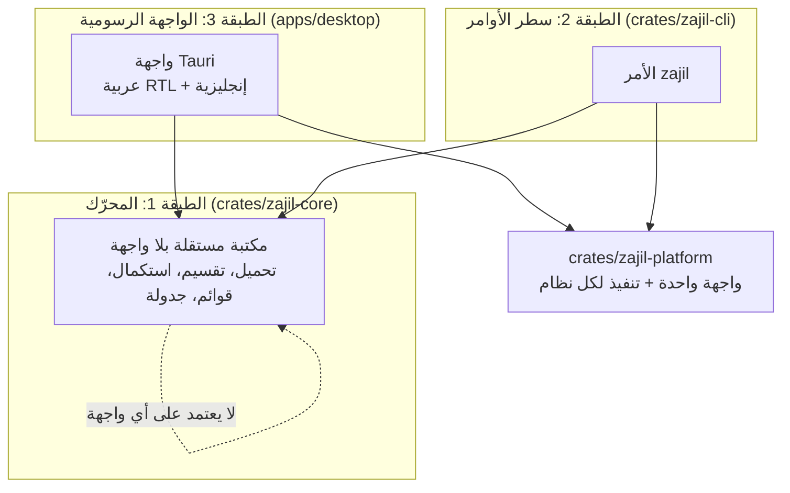
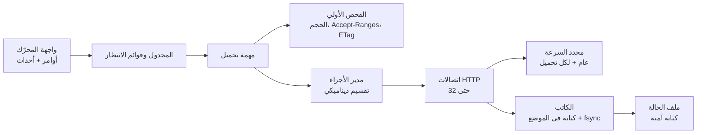
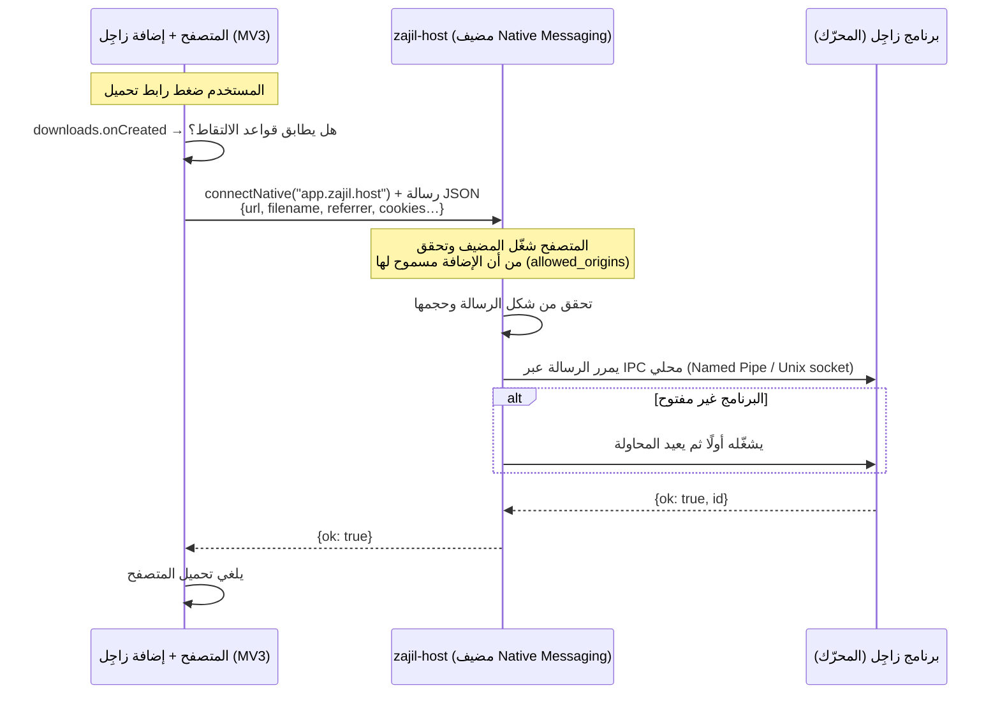

<div dir="rtl">

# بنية زاجِل (Architecture)

| البند | القيمة |
|---|---|
| الحالة | مسودة للموافقة (M0) |
| القرارات المرتبطة | [ADR-0003](adr/0003-language-and-ui-framework.md)، [ADR-0004](adr/0004-state-file-format.md)، [ADR-0005](adr/0005-extension-communication.md)، [ADR-0006](adr/0006-platform-abstraction.md) |

## 1. المبدأ: ثلاث طبقات، كل طبقة تعتمد على ما تحتها فقط



1. **المحرّك `zajil-core`**: مكتبة Rust لا تعرف شيئًا عن الواجهات. لا تطبع شيئًا على الشاشة، ولا تفتح نوافذ، ولا تقرأ إعدادات الواجهة. تستقبل أوامر (أضف، أوقف، استكمل…) وتُصدر **أحداثًا** (تقدّم، اكتمل، فشل…). ولهذا يمكن اختبارها بالكامل دون واجهة.
2. **سطر الأوامر `zajil`**: برنامج صغير فوق المحرّك. هو أول ما يُبنى (M1 إلى M3)، وهو أداة للمستخدمين المتقدمين وللاختبار.
3. **الواجهة الرسومية**: تطبيق Tauri فوق المحرّك (M4). لا تحتوي أي منطق تحميل، فهي تعرض الأحداث وترسل الأوامر فقط.

**قاعدة**: أي منطق يمكن أن يحتاجه أكثر من واجهة يوضع في المحرّك، وليس في الـ CLI أو الواجهة الرسومية.

## 2. خريطة المستودع (المخطط لها)

```text
zajil-download-manager/
├── crates/
│   ├── zajil-core/        # المحرّك (موجود الآن كمشروع فارغ)
│   ├── zajil-platform/    # واجهة الأنظمة + تنفيذ ويندوز/ماك/لينكس   (M1+)
│   ├── zajil-cli/         # الأمر zajil                              (M1)
│   ├── zajil-host/        # مضيف Native Messaging الصغير              (M5)
│   └── zajil-testserver/  # سيرفر تجريبي للحالات الصعبة (للاختبار فقط) (M1)
├── apps/desktop/          # تطبيق Tauri: الواجهة (M4)
├── extension/             # إضافة المتصفح MV3 لـ Chrome/Edge/Firefox (M5)
├── docs/                  # الوثائق والـ ADR
└── .github/               # الـ CI والقوالب
```

## 3. المحرّك من الداخل



### 3.1 دورة حياة التحميل
1. **الفحص**: طلب أولي يعرف الحجم (`Content-Length`)، وهل السيرفر يدعم `Accept-Ranges: bytes`، والـ `ETag` و`Last-Modified`، والاسم من `Content-Disposition`.
2. **التحضير**:
   - يُنظَّف اسم الملف (القسم 6).
   - يُنشأ ملف جزئي `<الاسم>.zajil-part` في مجلد التحميل، وتُحجز مساحته مسبقًا إن كان الحجم معروفًا.
   - يُنشأ ملف الحالة `<الاسم>.zajil-state` (ADR-0004).
3. **التحميل**: اتصال واحد في M1، ثم عدة اتصالات في M2.
4. **الاستكمال**: بعد الانقطاع يُرسل `Range: bytes=<الموضع>-` مع `If-Range: <ETag>`:
   - إذا رد السيرفر بـ `206`، يستمر التحميل.
   - إذا رد بـ `200`، فالملف تغيّر على السيرفر: يُحذف المحتوى الجزئي ويبدأ التحميل من جديد. **لا خلط أبدًا.**
5. **الإنهاء**: يُتحقق من الحجم (ومن البصمة إن كانت معروفة)، ثم يُعاد تسمية الملف الجزئي إلى اسمه النهائي **في خطوة واحدة**، ثم يُحذف ملف الحالة.

### 3.2 التقسيم الديناميكي (M2)
- يبدأ التحميل بعدد من الأجزاء يساوي عدد الاتصالات المسموح.
- عندما ينهي اتصال جزءه، يختار **الجزء الذي يحتاج أطول وقت متبقٍّ** (الحجم المتبقي ÷ سرعته الحالية)، ويقسم ما بقي منه إلى نصفين، ويأخذ النصف الثاني.
- لا يُقسم جزء إذا كان ما بقي منه أقل من حد أدنى (مثل 1 ميجابايت)، حتى لا نضيّع الوقت في فتح اتصالات لا داعي لها.
- إذا كان السيرفر لا يدعم التقسيم، يرجع المحرّك إلى اتصال واحد. وعند 403 أو 429 يقلل عدد الاتصالات بهذا السيرفر، ويحترم `Retry-After`.

### 3.3 ضمان سلامة البيانات
البيانات تُكتب في الملف الجزئي **وتُثبَّت على القرص (fsync) قبل** أن يسجل ملف الحالة أنها اكتملت. لذلك:
- إذا انقطعت الكهرباء، فأسوأ ما يحدث أن نعيد تحميل جزء صغير.
- ولن نعتبر أبدًا بيانات ناقصة أو فاسدة مكتملة.

## 4. الطبقة الخاصة بكل نظام (`zajil-platform`)

كل ما يختلف بين الأنظمة يمر عبر **واجهة واحدة (trait)** لها ثلاثة تنفيذات. الكود الذي فوقها لا يحتوي أي `if windows`. التفاصيل في [ADR-0006](adr/0006-platform-abstraction.md).

| الواجهة | ويندوز | ماك | لينكس |
|---|---|---|---|
| تسجيل مضيف Native Messaging | مفتاح في الريجستري (`HKCU\Software\…\NativeMessagingHosts\app.zajil.host`) يشير إلى ملف manifest | ملف manifest في مجلد كل متصفح داخل `~/Library/Application Support/…` | ملف manifest في `~/.config/…` لـ Chrome وChromium وEdge، و`~/.mozilla/native-messaging-hosts/` لـ Firefox |
| الحافظة | Win32 Clipboard | NSPasteboard | X11 أو Wayland |
| الإشعارات | Windows notifications | Notification Center | freedesktop notifications (D-Bus) |
| التشغيل مع بدء النظام | مفتاح `Run` في الريجستري | Login Item | ملف `.desktop` في `~/.config/autostart` |
| المسارات (الإعدادات، والبيانات، ومجلد التحميل) | `%APPDATA%` و`Known Folders` | `~/Library/Application Support` | معيار XDG |
| إيقاف الجهاز أو إدخاله في السكون بعد الانتهاء | Windows Shutdown API | macOS power APIs | systemd-logind (D-Bus) |
| الاتصال المحلي (IPC) | Named Pipe خاص بالمستخدم | Unix domain socket بصلاحية 0700 | Unix domain socket بصلاحية 0700 |

المثبّتات (M8): ‎.exe أو ‎.msi لويندوز، و‎.dmg لماك، وAppImage و‎.deb لينكس.

## 5. كيف تتصل الإضافة بالبرنامج

التفاصيل والخيارات المرفوضة في [ADR-0005](adr/0005-extension-communication.md).



النقاط المهمة:
- **المتصفح هو من يشغّل `zajil-host`**: المتصفح يقرأ ملف الـ manifest المسجَّل، ويرفض أي إضافة غير مذكورة فيه (`allowed_origins` في Chrome وEdge، و`allowed_extensions` في Firefox).
- **`zajil-host` برنامج صغير منفصل.** المتصفح يشغّل نسخة جديدة منه مع كل اتصال، ولذلك لا يمكن أن يكون هو البرنامج الرئيسي. وظيفته أن يتحقق من الرسالة ويمررها إلى البرنامج الرئيسي.
- **لا يوجد أي سيرفر HTTP على `localhost`.** أي موقع على الإنترنت يستطيع أن يرسل طلبات إلى `localhost`، فهذا الخيار مرفوض أمنيًا.
- **قناة الـ IPC خاصة بالمستخدم الحالي فقط**، بصلاحيات نظام التشغيل.
- **الرسائل لها مخطط محدد (schema) وحد أقصى للحجم**، وكل حقل غير متوقع يُرفض.

## 6. الأمان من أول يوم

| الخطر | الحماية |
|---|---|
| هجوم وسيط (MITM) | التحقق من شهادات TLS دائمًا (rustls مع مخزن شهادات النظام). **لا يوجد خيار لتعطيله**، لا في الواجهة ولا في الإعدادات ولا في متغيرات البيئة |
| كتابة خارج مجلد التحميل (path traversal) | تنظيف الاسم، ثم التأكد من أن المسار النهائي **داخل** مجلد التحميل بعد حل المسارات، ورفض الروابط الرمزية (symlinks) التي تخرج منه |
| أسماء ملفات خادعة | حذف رموز اتجاه النص الخفية (مثل U+202E)، ورموز التحكم، والأسماء المحجوزة في ويندوز، والنقاط والمسافات في نهاية الاسم، وتحديد طول الاسم |
| موقع خبيث يرسل أوامر للبرنامج | Native Messaging فقط، ومعرّفات إضافتنا فقط، ولا سيرفر محلي |
| تحديث مزيف | توقيع رقمي لكل تحديث يُتحقق منه قبل التثبيت، وTLS دائمًا (M8) |
| تسريب بيانات | لا تتبع ولا إحصاءات. الإضافة ترسل كوكيز الرابط المطلوب فقط |
| مكتبة خبيثة أو ترخيصها غير متوافق | `cargo-deny` في الـ CI يفحص التراخيص والثغرات المعروفة ومصادر المكتبات |

## 7. الاختبارات

- **اختبارات وحدة** داخل كل مكتبة.
- **اختبارات تكامل للمحرّك ضد `zajil-testserver`**: سيرفر محلي يعمل داخل الاختبار ويحاكي الحالات الصعبة:
  1. سيرفر يرفض التقسيم (يتجاهل `Range` ويرد بـ `200`).
  2. قطع الاتصال في منتصف الجزء.
  3. تغيّر الملف على السيرفر بين محاولتين (`ETag` مختلف).
  4. سيرفر بطيء جدًا، أو يتوقف عن الإرسال.
  5. رد `429` مع `Retry-After`، ورد `403` بعد عدد معين من الاتصالات.
  6. اسم ملف في `Content-Disposition` يحاول الكتابة خارج المجلد (`../../x`، أو مسار مطلق، أو `CON`، أو U+202E).
- **كل اختبار يعمل على الأنظمة الثلاثة في الـ CI.**
- **الإضافة (M5)**: اختبارات للكود، واختبار تكامل للمضيف بإرسال رسائل Native Messaging إليه.

## 8. الـ CI والإصدارات

- كل Pull Request: فحص التنسيق (`cargo fmt`)، و`clippy` (التحذيرات تُعامل كأخطاء)، والبناء والاختبار على **ويندوز وماك ولينكس**، و`cargo-deny` لفحص التراخيص والثغرات.
- الإصدارات (M8): تُبنى من الـ CI فقط عند وضع tag بصيغة SemVer، وترفق بها المثبّتات الموقّعة وبصمات SHA-256 ومقتطف من `CHANGELOG.md`.

</div>

---

## English summary

Zajil has three layers:

| Layer | What it is |
|---|---|
| `zajil-core` | A UI-less async Rust engine: commands in, events out |
| `zajil` | The CLI |
| Tauri desktop app | The GUI |

**Platform-specific code** lives behind traits in `zajil-platform`, with Windows, macOS and Linux implementations. This covers:
- native-messaging host registration
- clipboard
- notifications
- autostart
- paths
- shutdown/sleep
- IPC

**Browser path:** the MV3 extension uses `connectNative` to the small `zajil-host` relay. The browser enforces `allowed_origins` / `allowed_extensions`. The relay validates each message and forwards it over a per-user named pipe or Unix socket to the app. There is no localhost HTTP server.

**Data safety:** data is fsync'ed before the state file marks it done, and finalization is an atomic rename.

**Engine tests** run against a local test server that simulates:
- no range support
- mid-stream disconnects
- changed files
- slowness
- 403 and 429 responses
- path-traversal filenames

These tests run on all three operating systems.
