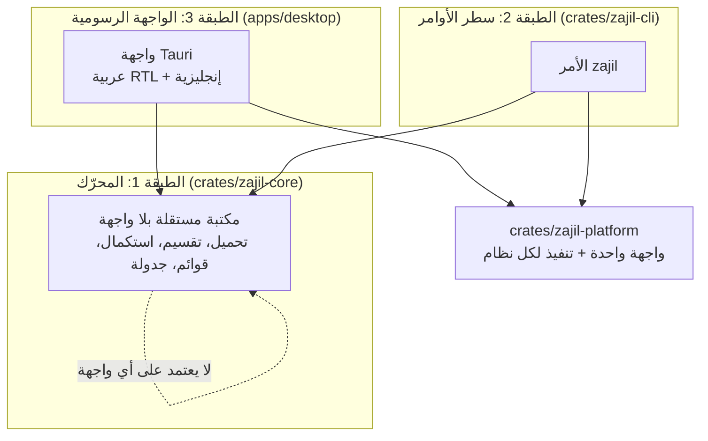
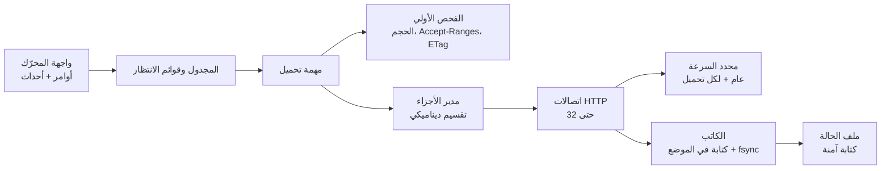
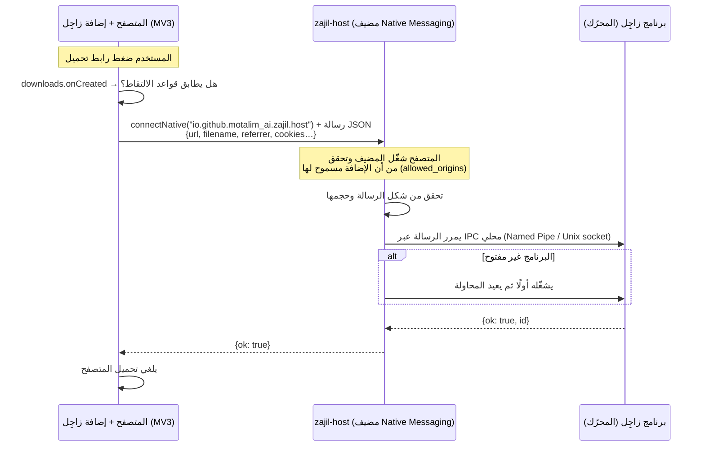

<div dir="rtl">

# بنية زاجِل (Architecture)

| البند | القيمة |
|---|---|
| الحالة | مسودة للموافقة (M0) |
| القرارات المرتبطة | [ADR-0003](adr/0003-language-and-ui-framework.md)، [ADR-0004](adr/0004-state-file-format.md)، [ADR-0005](adr/0005-extension-communication.md)، [ADR-0006](adr/0006-platform-abstraction.md) |

## 1. المبدأ: ثلاث طبقات، كل طبقة تعتمد على ما تحتها فقط



1. **المحرّك `zajil-core`**: مكتبة Rust لا تعرف شيئًا عن الواجهات. لا تطبع شيئًا على الشاشة، ولا تفتح نوافذ، ولا تقرأ إعدادات الواجهة. تستقبل أوامر (أضف، أوقف، استكمل…) وتُصدر **أحداثًا** (تقدّم، اكتمل، فشل…). ولهذا يمكن اختبارها بالكامل دون واجهة.
2. **سطر الأوامر `zajil`**: برنامج صغير فوق المحرّك. هو أول ما يُبنى (M1 إلى M3)، وهو أداة للمستخدمين المتقدمين وللاختبار.
3. **الواجهة الرسومية**: تطبيق Tauri فوق المحرّك (M4). لا تحتوي أي منطق تحميل، فهي تعرض الأحداث وترسل الأوامر فقط.

**قاعدة**: أي منطق يمكن أن يحتاجه أكثر من واجهة يوضع في المحرّك، وليس في الـ CLI أو الواجهة الرسومية.

## 2. خريطة المستودع (المخطط لها)

```text
zajil-download-manager/
├── crates/
│   ├── zajil-core/        # المحرّك (موجود الآن كمشروع فارغ)
│   ├── zajil-platform/    # واجهة الأنظمة + تنفيذ ويندوز/ماك/لينكس   (M1+)
│   ├── zajil-cli/         # الأمر zajil                              (M1)
│   ├── zajil-host/        # مضيف Native Messaging الصغير              (M5)
│   ├── zajil-i18n/        # الترجمات (Fluent) لجهة Rust               (M4)
│   └── zajil-testserver/  # سيرفر تجريبي للحالات الصعبة (للاختبار فقط) (M1)
├── apps/desktop/          # تطبيق Tauri: الواجهة (M4)
├── locales/               # ملفات الترجمة ar وen (Fluent)، للواجهة ولجهة Rust (M4)
├── extension/             # إضافة المتصفح MV3 لـ Chrome/Edge/Firefox (M5)
├── docs/                  # الوثائق والـ ADR
└── .github/               # الـ CI والقوالب
```

## 3. المحرّك من الداخل



### 3.1 دورة حياة التحميل
1. **الفحص**: طلب أولي يعرف الحجم (`Content-Length`)، وهل السيرفر يدعم `Accept-Ranges: bytes`، والـ `ETag` و`Last-Modified`، والاسم من `Content-Disposition`.
2. **التحضير**:
   - إذا كان الحجم معروفًا، يجب أن يتسع له المكان الحر في المجلد (`available_space`)، **قبل إنشاء أي ملف**. والحجم يأتي من السيرفر، فالحجم الضخم أو الكاذب يُرفض هنا برسالة واضحة (`NotEnoughSpace`). هذا هو الحد الأعلى لـ `Content-Length`.
   - يُنظَّف اسم الملف (القسم 6).
   - يُنشأ ملف جزئي `<الاسم>.zajil-part` في مجلد التحميل، ويُعطى حجمه بـ `zajil_platform::fs::allocate` (القسم 4).
   - يُنشأ ملف الحالة `<الاسم>.zajil-state` (ADR-0004).
3. **التحميل**:
   - **عدة اتصالات** (حتى 32، والافتراضي 8): فقط إذا أعلن السيرفر `Accept-Ranges: bytes`، وأعطى الحجم، ومُحقِّقًا قويًا. التفاصيل في القسم 3.2.
   - **اتصال واحد** في غير ذلك، أو إذا كان الملف أصغر من جزأين (الحد الأدنى للجزء 1 ميجابايت).
4. **الاستكمال** (`zajil resume <ملف-الحالة>`): يُقرأ ملف الحالة ويُتحقق منه، ويُقفل الملف الجزئي، ثم يُرسل `Range: bytes=<الموضع>-` مع `If-Range` حسب RFC 9110 §13.1.5 بالضبط: الـ `ETag` إن كان قويًا. ولا يُرسل `ETag` ضعيف (`W/`) أبدًا. ولا يُستخدم `Last-Modified` إلا إذا لم يوجد أي `ETag`، وكان «قويًا» (§8.8.2.2): قبل ترويسة `Date` في نفس الرد بثانية على الأقل، ولهذا تُحفظ `Date` في ملف الحالة. ويُطلب `final_url` أولًا، وإذا فشل (رابط CDN منتهٍ مثلًا) يُطلب الرابط الأصلي:
   - إذا رد السيرفر بـ `206`، ويبدأ `Content-Range` من موضعنا بالضبط، والحجم والـ `ETag` كما هما، يستمر التحميل من الموضع نفسه.
   - إذا رد بـ `200`، فالملف تغيّر على السيرفر أو السيرفر يتجاهل التقسيم: يُكتب الملف من البداية من هذا الرد نفسه. **لا خلط أبدًا.**
   - ويبدأ التحميل من جديد أيضًا إذا لم يوجد مُحقِّق قوي (لا يمكن كشف تغيّر الملف بأمان)، أو كان الملف الجزئي مفقودًا أو أقصر مما يقول ملف الحالة. والمحرّك يُصدر حدث `Restarted` بالسبب.
   - ملف الحالة الفاسد يُرفض قبل أي طلب، ولا يُلمس الملف الجزئي.
   - **ملف الحالة وما بجانبه مُدخلات غير موثوقة** (قد تأتي من جهاز آخر). لذلك: يُحوَّل المسار إلى مسار مطلق داخل المجلد الحقيقي، ويجب أن يكون الاسم نظيفًا (لا يغيّره `sanitize_file_name`)، ويُرفض أي `.zajil-state` أو `.zajil-part` يكون رابطًا رمزيًا أو رابطًا صلبًا أو غير ملف عادي، بفحص الملف **بعد فتحه** (`open_regular_nofollow`). و`.zajil-state.tmp` يُحذف ولا يُتبع أبدًا.
5. **الاسم**: لا يُكتب فوق ملف موجود أبدًا. إذا كان الاسم مستخدمًا (الملف النهائي أو ملف جزئي أو ملف حالة)، يُجرَّب `الاسم (1).امتداد` ثم `(2)`… (ويُقصَّر الجزء الأساسي من الاسم قبل إضافة الرقم، فلا يتجاوز الاسم 200 بايت أبدًا) والملف الجزئي يُنشأ بـ `create_new` ويُقفل طوال التحميل. وعند الإنهاء تُستخدم إعادة تسمية لا تستبدل أبدًا (`zajil_platform::fs::rename_noreplace`)، فإذا ظهر ملف بنفس الاسم أثناء التحميل، يأخذ الملف المكتمل اسمًا مرقّمًا.
   - **أقراص بلا روابط صلبة** (قرار المالك، M2): بعض أنظمة الملفات ترفض إعادة التسمية دون استبدال، **وترفض أيضًا** البديل (رابط صلب ثم حذف). مثال مختبر: exFAT في ماك. في هذه الحالة فقط يُفحص الاسم، ثم تُستخدم إعادة تسمية عادية (`check_then_rename`). وعلى كل الأقراص الأخرى تبقى الطريقة الأصلية.
   - **نافذة السباق**: إذا أنشأ برنامج آخر ملفًا بنفس الاسم في اللحظة بين الفحص وإعادة التسمية، فإنه يُستبدل. أما تحميلات زاجِل نفسها فلا تتسابق هنا، لأن كل تحميل يعيد التسمية إلى اسم يملك ملفه `.zajil-part`، أو إلى اسم حر لم يحجزه أحد.
   - **مختبر في الـ CI** على صور أقراص FAT32 وexFAT على الأنظمة الثلاثة. في لينكس يُركَّب exFAT عبر برنامج FUSE إذا لم تكن وحدة النواة موجودة في جهاز الـ CI، وهذا ما وجدناه حتى الآن. أما برنامج النواة نفسه وSMB فيُختبران يدويًا ([MANUAL-TESTS](MANUAL-TESTS.md)).
6. **الإنهاء**: يُتحقق من الحجم (ومن البصمة إن كانت معروفة)، ثم يُعاد تسمية الملف الجزئي إلى اسمه النهائي **في خطوة واحدة**، ثم يُحذف ملف الحالة.

### 3.2 التقسيم (M2)

**المطبَّق الآن** (`crates/zajil-core/src/segmented.rs`):
- **الأجزاء**: يُقسم الملف إلى أجزاء متصلة ومتساوية، بعدد الاتصالات، ولا يقل الجزء عن 1 ميجابايت. والأجزاء تُحفظ في ملف الحالة (`segments`).
- **الاتصال الأول**: هو رد الفحص الأول نفسه (`200` بالملف كاملًا)، فلا يضيع. وكل اتصال آخر يطلب جزءه بـ `Range: bytes=a-b` مع `If-Range`.
- **قبول الرد**: يُقبل الرد فقط إذا كان `206` و`Content-Range` هو الجزء المطلوب بالضبط، لملف بنفس الحجم ونفس النسخة.
  - إذا رد السيرفر بـ `200` وتغيّر الملف: يتوقف كل شيء، ويبدأ التحميل من جديد من هذا الرد (حدث `Restarted` بالسبب `FileChanged`). ولا تُخلط النسختان أبدًا.
  - إذا رد بـ `200` ولم يتغيّر الملف (السيرفر يتجاهل التقسيم): لا تُرسل طلبات تقسيم أخرى، والاتصال الأول يكمل.
- **من يكتب ماذا**: كل اتصال يملك جزءًا واحدًا في كل لحظة، ويكتب في موضعه عبر الـ handle المقفول (`write_at`). ويحجز البايتات قبل أن يكتبها. ولا يأخذ اتصال جزءًا فيه بايت مكتوب أو محجوز.
- **الاتصال الذي ينهي جزءه** يكمل في الجزء التالي إذا لم يُكتب فيه شيء بعد. هكذا يُقرأ سيرفر يتجاهل التقسيم حتى النهاية على اتصال واحد. وإلا يأخذ أول جزء حر.
- **الحفظ**: يُنسخ الوضع، ثم `sync_data`، ثم يُحفظ المنسوخ. فملف الحالة لا يعدّ أبدًا بايتات لم تُثبَّت على القرص.
- **الاستكمال**: أول جزء ناقص يُطلب أولًا، مع الرجوع إلى الرابط الأصلي إذا فشل `final_url`، ويُفحص كما في M1. ثم يأخذ كل اتصال جزءًا ناقصًا من أول بايت ينقصه.
- **إعادة استخدام الاتصالات**: عبر مجمّع `reqwest` (keep-alive). مختبر: ثمانية أجزاء على اتصالين.
- **اسم المستخدم وكلمة المرور في الرابط** (`user:pass@`): يُرسلان مع كل طلب جزء، لكن فقط إذا كان الرابط النهائي على نفس المصدر (origin)، كما يفعل `reqwest` في التحويلات. ويبقيان في الذاكرة فقط، ولا يُكتبان في ملف الحالة. مختبر: سيرفر يشترط `Authorization` على كل طلب، وتحويل إلى سيرفر آخر لا يصله شيء منهما. ولهذا لا يملكهما الاستكمال من ملف الحالة.
- **ملف «يتغير» أثناء التقسيم**: بعض السيرفرات وراءها عدة أجهزة، ولكل جهاز `ETag` مختلف للملف نفسه. فإذا ظهر تغيّر بعد بدء التقسيم، يبدأ التحميل من جديد **على اتصال واحد**، من الرد الذي أظهر التغيّر. واتصال واحد يبقى على جهاز واحد. مختبر بسيرفر يتبدل `ETag` فيه حسب الاتصال (وجدته مراجعة #24).

**التقسيم الديناميكي**:
- **متى**: عندما لا يجد اتصال جزءًا حرًا.
- **أي جزء**: يختار الجزء الذي يحتاج **أطول وقت متبقٍّ**، أي ما بقي منه (لم يُكتب ولم يُحجز) ÷ سرعة اتصاله منذ أخذه.
  - لا يُحكم على اتصال قبل نصف ثانية من العمل.
  - الاتصال الذي لم يرسل شيئًا لمدة ثانية يُعد متوقفًا، فيُقسم جزؤه أولًا.
- **التقسيم**: يُقسم ما بقي نصفين، ويأخذ الاتصال الحر النصف الثاني بطلب `Range` جديد، ويتوقف الاتصال القديم عند بداية الجزء الجديد.
- **الحد الأدنى**: لا يُقسم جزء إذا كان نصف ما بقي منه أقل من الحد الأدنى للجزء (1 ميجابايت افتراضيًا)، حتى لا نضيّع الوقت في فتح اتصالات لا داعي لها.
- **الانتظار**: إذا كانت كل الاتصالات أحدث من أن يُحكم عليها، ينتظر الاتصال الحر قليلًا ثم ينظر مرة أخرى. وإذا لم يبقَ ما يستحق التقسيم، ينتهي.
- **التسجيل**: كل تقسيم يُعلن بحدث `Event::Split { segment, at }`، ويُحفظ في ملف الحالة مع الحفظ التالي، فيمكن الاستكمال بعده.
- **ملاحظة للواجهات**: إلغاء التحميل بإسقاط الـ future يوقف الاتصالات، لكن الملف الجزئي يبقى مقفولًا لحظات، حتى تنتهي مهامها وكتاباتها الجارية. هذا مقصود: تحرير القفل قبل ذلك قد يسمح لكتابة متأخرة أن تقع في ملف بدأ من جديد. والاستكمال الفوري في نفس العملية قد يرى `Locked`. وطريقة «أوقف وانتظر» (`Stop`) جاءت مع القوائم في M3 (القسم 3.3): لا تعود إلا بعد أن يتوقف كل شيء.

**إعادة المحاولة والسيرفر المشغول** (`crates/zajil-core/src/retry.rs`):
- **الأعطال المؤقتة**: إذا انقطع اتصال، أو انتهت مهلته، أو رد السيرفر بـ `5xx` أو `408`، يعود جزؤه إلى الطابور بعد انتظار.
  - الانتظار يتضاعف: نصف ثانية، ثم ثانية، ثم ثانيتان…، وأقصاه 30 ثانية.
  - فيه عنصر عشوائي: بين نصف السقف والسقف (equal jitter)، حتى لا تعود الاتصالات كلها في اللحظة نفسها.
  - الاستكمال من أول بايت ناقص في الجزء، لا من بدايته.
- **الاستسلام**: بعد 5 أعطال متتالية دون كتابة أي بايت بينها، يُترك الجزء، فيتوقف التحميل قابلًا للاستكمال برسالة فيها السبب.
- **429**:
  - لا يُرسل أي طلب إلى السيرفر قبل انتهاء `Retry-After` (بالثواني أو بتاريخ HTTP). وإذا لم يوجد، يُستخدم الانتظار المتضاعف.
  - إذا طلب السيرفر أكثر من 10 دقائق، لا ننتظر: يتوقف التحميل قابلًا للاستكمال.
- **403 أو 429 بينما تعمل اتصالات أخرى**: معناه أن السيرفر يحدد عدد الاتصالات. فينخفض الحد إلى عدد الاتصالات التي قبلها، ولا يرتفع مرة أخرى في هذا التحميل. ويعود الجزء إلى الاتصالات الباقية. أما 403 على الاتصال الوحيد فهو رفض حقيقي، فيُترك الجزء.
- **التسجيل**: كل ذلك يُعلن بحدث `Event::ServerBusy { status, connections, wait }`.
- **ملاحظة**: السيرفر قد يعدّ لحظات اتصالًا أغلقناه للتو، فيرفض طلبًا جديدًا ونحن ضمن حده. حينها ينخفض الحد واحدًا إضافيًا. هذا حذر مقبول، والتحميل يكتمل.
- **الطلب الأول والاتصال الواحد (M3)**، بقرار المالك على #28، وبنفس السياسة:
  - كل طلب (الطلب الأول، وطلبات الاستكمال والبدء من جديد) يُعاد إذا فشل لسبب قد يزول: اتصال لم يُفتح أو انقطع، أو مهلة انتهت، أو `5xx` أو `408` أو `429`.
  - **لا يُعاد أبدًا**: شهادة غير موثوقة، أو تحويل مرفوض، أو أي رد آخر مثل `403` و`404`.
  - و`429` ينتظر `Retry-After`، فإذا طلب أكثر من 10 دقائق لا ننتظر (`Error::ServerBusy`).
  - **التحميل باتصال واحد إذا انقطع**: يُحفظ ما على القرص أولًا، ثم يُطلب الباقي بـ `Range` و`If-Range`. وإذا لم يستطع السيرفر أن يكمل من هناك (لا مُحقِّق قوي، أو تجاهل التقسيم، أو تغيّر الملف)، يبدأ التحميل من البايت 0 من الرد الكامل نفسه، بحدث `Restarted`. **لا خلط أبدًا.**
  - **التقدم** يعني تجاوز أبعد بايت وصل إليه التحميل في هذه المحاولة. فالسيرفر الذي لا يكمل من المنتصف وينقطع دائمًا في نفس الموضع يُترك بعد 5 مرات، ولا يُعاد إلى ما لا نهاية.
  - كل إعادة تُعلن بحدث `Event::Retrying { wait, reason }`، والسبب لا يحتوي التوكن ولا بيانات الدخول.
  - العدد قابل للتغيير: `Options::max_failures`، و`zajil --tries`. والقيمة 1 تعني بلا إعادة.
- **تغيّر الملف أثناء التقسيم** (قرار المالك على #28): الإكمال على اتصال واحد مقبول. والاختبار `a_change_during_splitting_leaves_only_the_new_version` يثبت أن الملف النهائي هو النسخة الجديدة كاملة، دون أي بايت من القديمة، مع أن أغلب القديمة كانت على القرص.

### 3.3 القوائم (M3)

**المطبَّق** (`crates/zajil-core/src/queue/`، [ADR-0007](adr/0007-queues-and-settings-storage.md)، [QUEUES-FILE](QUEUES-FILE.md)):
- **القوائم والإعدادات** في ملف واحد، `queues.json`، في مجلد البيانات. والتعديل يمر دائمًا عبر `QueueStore::update` بقفل بين العمليات.
- **المشغّل** (`Runner`، و`zajil queue run`):
  - يبدأ التحميلات المنتظرة بالترتيب، ولا يتجاوز `max_active` لكل قائمة.
  - يقرأ الملف عند كل تغيير، ومرتين في الثانية ليرى تعديلات العمليات الأخرى.
  - نسخة واحدة فقط تعمل (`runner.lock`).
- **«أوقف وانتظر»** (`Stop`، و`Engine::download_until` و`resume_until`):
  - عند الطلب يتوقف الاستقبال، وتنتهي كل الاتصالات، ويُثبَّت ما على القرص ويُسجَّل.
  - **ثم فقط** تعود الدالة بـ `Error::Stopped`: لا كتابة ولا حفظ يعمل بعدها، والملف الجزئي مغلق وغير مقفول.
  - فالاستئناف الفوري في نفس العملية آمن، ولا يكتب حفظ قديم فوق حالة أحدث (الملاحظة المؤجلة في #5).
  - أما إسقاط الـ future فما زال يوقف التحميل كما في M2، لكن آخر الحفظات قد تنتهي بعده.
- **المشغّل الذي قُتل** يترك تحميلات بحالة `active`، فتعود إلى `waiting` في التشغيل التالي، وتُستكمل من ملفات حالتها.

**حد السرعة** (`crates/zajil-core/src/limit.rs`):
- **حدان**: حد للبرنامج كله (`zajil queue speed-limit`، في `settings.speed_limit` في ملف القوائم)، وحد لكل تحميل (`zajil get --limit`، و`zajil queue add --limit`). وتغيير حد البرنامج يصل إلى التحميلات الجارية خلال نصف ثانية.
- **الطريقة**: دلو رموز (token bucket) يمر به كل اتصال.
  - الاتصال يأخذ من الدلو **كل قطعة فور وصولها**، ثم ينتظر قبل أن يقرأ المزيد. والدلو قد يدخل في دَين، فينتظر كل اتصال دوره في سداده. وكان يأخذ بعد كتابة دفعة كاملة (256 كيلوبايت)، فكانت أول دفعة من كل اتصال تمر بالسرعة الكاملة (مراجعة #32: من 3 إلى 6 أضعاف الحد في الثانية الأولى). ومختبر الآن أن المكتوب لا يتقدم على الحد في أي لحظة.
  - **تغيير الحد** (أو إزالته) يوقظ الاتصالات المنتظرة، فتنتظر بالمعدّل الجديد (مراجعة #32: كانت تنتظر بالمعدّل القديم حتى دقائق).
  - **الرصيد المدخر محدود** بعُشر ثانية من الحد، فلا تأتي دفعة كبيرة بعد توقف.
  - تقليل القراءة يجعل TCP يبطئ السيرفر، فيصح الحد على الشبكة أيضًا.
- **حدّان معًا**: يُحجز من الاثنين أولًا، ثم ينتظر الاتصال حتى أبعد الموعدين. الانتظار عند أحدهما ثم الآخر كان يجمع الانتظارين، فتصير السرعة أقل من أصغر الحدين (0.83 منه، وجده اختبار).
- **ما يُحسب**: كل قطعة تصل. وما يرميه الاتصال بعد ذلك دون أن يكتبه (ما قرأه بعد نهاية جزئه) **يُرَدّ إلى الدلو رصيدًا** تستعمله القراءات التالية. لذلك يصل الملف بسرعة الحد في المتوسط، وقد تحمل الشبكة أكثر منه. ولتقليل هذا الهدر، يكتب الاتصال فورًا عندما يتجاوز نهاية جزئه، فيعرف هل يكمل في الجزء التالي. **وما دام حد فعّالًا، يكتب كل قطعة فور وصولها** بدل دفعات 256 كيلوبايت: الدفعة التي يتركها التقسيم كانت تُرمى، وقرب نهاية التحميل لا تبقى قراءة تستعمل رصيدها (قاس الـ CI مرة 0.89 من الحد. وبعد الإصلاح كانت أدنى نسبة 0.96، تحت حمل ست نسخ متوازية). **ما لم يُحل بعد**: الطلب الأول مفتوح النهاية، فالسيرفر قد يرسل أكثر مما يقرؤه الاتصال (مراجعة #32، مؤجل).
- **الساعة** (`Clock`): الحقيقية في البرنامج، و`ManualClock` في الاختبارات: لا تتحرك إلا عندما يجعل الحد تحميلًا ينتظر، فالوقت الذي تعرضه هو بالضبط ما كلّفه الحد، مهما كانت سرعة الجهاز. لم نستعمل `tokio::time::pause`، لأنه يقدّم الوقت أيضًا لمهلات الاتصال الحقيقية بينما ننتظر الشبكة.
- **بالساعة الحقيقية**: اختبار واحد في كل PR (`the_real_clock_drives_limits_and_schedules`). واختبار ثانٍ للثانية الأولى من الحد (`speed_limit_real_clock.rs`) يعمل كل ليلة فقط، بقرار المالك على #36، البند 14 (وانظر القسم 8 هنا).

**الجدولة** (`crates/zajil-core/src/queue/schedule.rs`):
- **نافذة لكل قائمة** كل يوم، بالتوقيت المحلي: من `start` (00:00 إن لم يُحدد) إلى `stop` (منتصف الليل إن لم يُحدد). وإذا لم تكن `stop` بعد `start`، تنتهي النافذة في اليوم التالي. و`days` تحدد الأيام التي تبدأ فيها النافذة.
- **التوقيت المحلي** من منطقة النظام الزمنية مع قواعد التوقيت الصيفي (مكتبة `jiff`). البداية التي تقع في ساعة محذوفة تحدث بعدها مباشرة، وفي الساعة المكررة تحدث أول مرة. مختبر بمنطقة نيويورك.
- **المشغّل**:
  - خارج النافذة لا يبدأ شيئًا من القائمة، ويوقف تحميلاتها الجارية بطريقة «أوقف وانتظر»، فتعود إلى الانتظار.
  - ينام حتى أقرب تغيير في أي نافذة (على ساعة المحرّك)، ويُصدر `QueueEvent::Waiting { queue, until }`.
  - ولا ينتهي ما دام في قائمة مجدولة تحميل ينتظر.
- **الساعة في الاختبارات**: `ManualClock::frozen`، لا تتحرك إلا عندما يقدّمها الاختبار. فـ«الساعة الآن 23:00» دقيقة ولا تعتمد على سرعة الجهاز.

### 3.4 ضمان سلامة البيانات
البيانات تُكتب في الملف الجزئي **وتُثبَّت على القرص (fsync) قبل** أن يسجل ملف الحالة أنها اكتملت. لذلك:
- إذا انقطعت الكهرباء، فأسوأ ما يحدث أن نعيد تحميل جزء صغير.
- ولن نعتبر أبدًا بيانات ناقصة أو فاسدة مكتملة.

**ما اختُبر فعلًا**: قطع الاتصال، وإيقاف العملية بالقوة (kill). أما انقطاع الكهرباء الحقيقي فلم يُختبر على أي نظام، لأن قتل العملية يُبقي ذاكرة النظام المؤقتة. وفي ويندوز تعتمد إعادة التسمية على `MOVEFILE_WRITE_THROUGH` بدل `fsync` للمجلد.

### 3.5 الفئات (M4)

**المطبَّق** (`crates/zajil-core/src/category.rs`، [CATEGORIES-FILE](CATEGORIES-FILE.md)):
- **ملف منفصل** `categories.json` بجانب `queues.json`، بقرار المالك: الفئات إعدادات يعدّلها المستخدم، والقوائم حالة عمل. وبنفس قواعده: البصمة، والقراءة الصارمة، والكتابة الآمنة، والقفل.
- **الفئة**: أول فئة فيها موقع يطابق مضيف الرابط النهائي، ثم أول فئة فيها امتداد الملف، وإلا لا فئة.
- **المجلد يُختار بعد أن يرد السيرفر** وقبل إنشاء أي ملف (`Engine::download_choosing_until`)، لأن الاسم قد يأتي من `Content-Disposition`. والقوائم تعرف التحميل الذي يذهب بالفئة من `items[].categorize`.
- **الفئات المدمجة بلا مجلدات** حتى يختار المستخدم، فلا تظهر مجلدات لم يطلبها.

### 3.6 الترجمة (M4)

- **ملف واحد لكل لغة**: `locales/ar/zajil.ftl` و`locales/en/zajil.ftl`، بنظام Fluent (ADR-0003). تقرؤه الواجهة بـ `@fluent/bundle` (ADR-0008)، وجهة Rust بـ `zajil-i18n`، وهي لقائمة شريط النظام والإشعارات. وسطر الأوامر يبقى بالإنجليزية (قرار المالك).
- **صيغ الجمع العربية الست** تُختار دائمًا بالدالة `PLURAL($count)`، وهي تعيد اسم فئة CLDR: في Rust من ICU4X (`icu_plurals`)، وفي الواجهة من `Intl.PluralRules`.
  - **لماذا لا يُختار بـ `$count` مباشرة**: قواعد الجمع داخل `fluent-bundle` (المكتبة `intl_pluralrules` 7.0.2) تعطي 103 و111 بالعربية الفئة «other»، والصحيح «few» و«many». وجدته اختبارات `zajil-i18n`.
  - واختبار يرفض أي رسالة تختار بالمتغير نفسه.
- **العزل**: القيم داخل الجملة تُحاط بعلامتي العزل U+2068 وU+2069، فيبقى اسم الملف اللاتيني باتجاهه داخل الجملة العربية.

### 3.7 الواجهة (M4)

**المطبَّق** (`apps/desktop`، [ADR-0008](adr/0008-ui-library.md)):
- **Tauri 2 فوق المحرّك**، بلا أي منطق تحميل (القسم 1). جهة Rust (`src-tauri/src/lib.rs`):
  - **تشغّل القوائم** بـ `Runner` طوال فتح النافذة: إذا انتهى لأن لا شيء بقي، يعود عندما يظهر تحميل منتظر.
  - **أوامر الواجهة** تمر عبر ملف القوائم نفسه، كما في `zajil queue`: الإيقاف المؤقت، والاستكمال، والحذف.
- **الأحداث**: أحداث المشغّل تُجمع في الذاكرة (البايتات، والسرعة، والملف). والصفحة تُخبر بحدث `downloads-changed`، 4 مرات في الثانية على الأكثر، وفورًا عند بدء تحميل أو انتهائه. ثم تطلب لقطة كاملة (`snapshot`).
- **الأنواع** بين الطرفين تُولَّد من Rust (ts-rs) في `src/lib/bindings/`، والـ CI يتأكد أنها محدّثة.
- **الصلاحيات** (`capabilities/default.json`): أوامر زاجِل وأحداثه، وتغيير عنوان النافذة. لا ملفات، ولا shell، ولا شبكة من الصفحة.
- **الإغلاق**: إغلاق النافذة يطلب من التحميلات أن تتوقف بعد تسجيل تقدمها، وينتظر القوائم حتى تتوقف (5 ثوانٍ على الأكثر)، ثم يخرج البرنامج بالرمز 0. وإذا لم تتوقف خلال الـ 5 ثوانٍ يخرج على أي حال: تقدّم كل تحميل في ملف حالته، وعمره ثانية على الأكثر (ADR-0004)، فيكمل منه عند الفتح التالي. ونفس الطريق مع SIGTERM وSIGINT وSIGHUP في لينكس وماك (إطفاء لينكس يرسل SIGTERM)، ومعالجها يُسجَّل قبل أن تفتح النافذة. **وفي ماك** يُنهي النظام البرنامج دون أن يسأله عند Cmd+Q، وQuit في الـ Dock، والخروج من الحساب، والإطفاء (حدث Quit من النظام): فيُمسك الخروج في آخره (`RunEvent::Exit`) حتى تتوقف التحميلات، بنفس الحد. والـ CI يتأكد على الأنظمة الثلاثة أن النافذة تفتح وتحمّل صفحتها ثم تُقفل هكذا خلال 4.5 ثانية بعد أن تقول إن التحميلات توقفت (`scripts/open-close.mjs`، ومعه حدث Quit في ماك)، وأن التحميل الذي قُفل التطبيق أو قُتل في منتصفه يكمل من آخر تقدم مسجَّل عند الفتح التالي، والملف سليم (`src-tauri/tests/close_resume.rs`). وفي ويندوز، حفظ التقدم عند إطفاء الجهاز أو الخروج من الحساب لم يُنفَّذ بعد (#49).
- **اسم الملف المختلط** (`src/lib/fname.ts`): الاسم كله معزول واتجاهه من أول حرف قوي فيه. والامتداد يلتصق بآخر كلمة ويأخذ اتجاهها: بعد كلمة عربية يبقى في تدفق النص، فتلتصق النقطة بالكلمة. وبعد نص لاتيني يكون مع ذلك النص وحدة واحدة من اليسار إلى اليمين.

## 4. الطبقة الخاصة بكل نظام (`zajil-platform`)

كل ما يختلف بين الأنظمة يمر عبر **واجهة واحدة (trait)** لها ثلاثة تنفيذات. الكود الذي فوقها لا يحتوي أي `if windows`. التفاصيل في [ADR-0006](adr/0006-platform-abstraction.md).

**`unsafe`**: ممنوع في كل المكتبات (`forbid`)، إلا في `zajil-platform` حيث هو `deny`، ومسموح فقط في وحدة `fs` لاستدعاءات نظام لا توفرها المكتبة القياسية: إعادة التسمية دون استبدال (`renameat2` في لينكس، و`renamex_np` في ماك، و`MoveFileExW` في ويندوز)، و`MOVEFILE_WRITE_THROUGH`، وعدد الروابط الصلبة في ويندوز. ومنذ M2: حجز المساحة (`fallocate` في لينكس، و`F_PREALLOCATE` في ماك)، والملف المتناثر في ويندوز (`FSCTL_SET_SPARSE`)، والمساحة الحرة (`statvfs` و`statfs` و`GetDiskFreeSpaceExW`). ومنذ M3: حذف قائمة الصلاحيات الموروثة في ماك (`acl_set_fd_np`، وقراءتها بـ `acl_get_fd_np` للفحص)، وملف لا يقرؤه إلا صاحبه في ويندوز (`CreateFileW` مع قائمة صلاحيات محمية من `ConvertStringSecurityDescriptorToSecurityDescriptorW`، وقراءتها بـ `GetNamedSecurityInfoW` للفحص). ومنذ M3 أيضًا وحدة `power` في ويندوز: `AdjustTokenPrivileges` و`InitiateShutdownW` و`SetSuspendState`. كل استدعاء معه تعليق `SAFETY`.

**`PowerControl` (M3)**:
- **لا يُستدعى إلا بطلب صريح** من المستخدم لقائمة واحدة في تشغيل واحد (`--shutdown-after` أو `--sleep-after`)، والطلب لا يُحفظ.
- **لا يحدث إلا إذا اكتملت كل تحميلات القائمة، واحد منها على الأقل في هذا التشغيل**، وبعد عد تنازلي يلغيه Ctrl+C (`zajil_core::queue::after_queue`). وإذا فشل تحميل منها أو أُوقف مؤقتًا، يكمل التشغيل كأن شيئًا لم يُطلب، ولا يتوقف أي تحميل آخر (مراجعة #35).
- **الاختبارات تستعمل تنفيذًا وهميًا فقط**، و`power_guard.rs` يتأكد من ذلك.
- **سياج أخير**: التنفيذ الحقيقي يرفض العمل ما دام `ZAJIL_NO_POWER_ACTIONS` مضبوطًا، والـ CI يضبطه. هذا المتغير يمنع فقط، ولا يسبب إيقافًا أبدًا.

**الملفات في M2** (`zajil_platform::fs`):
- `write_at`: كل الاتصالات تكتب عبر الـ handle المقفول نفسه، كلٌّ في موضعه. السبب: القفل في ويندوز خاص بكل handle، فلا يستطيع handle آخر أن يكتب.
- `available_space` و`allocate`: إعطاء الملف الجزئي حجمه النهائي. **قرار المالك (M2)**: فحص المساحة الحرة على الأنظمة الثلاثة قبل البدء، ثم حجز حقيقي في لينكس وماك حيث يدعمه نظام الملفات، وملف متناثر في ويندوز. السبب: في NTFS، الكتابة في موضع بعيد تجعل ويندوز يملأ ما قبله بالأصفار أولًا، فيُكتب الملف المقسَّم مرتين تقريبًا.
- `rename_noreplace` على FAT وexFAT: انظر القسم 3.1، الخطوة 5.

| الواجهة | ويندوز | ماك | لينكس |
|---|---|---|---|
| تسجيل مضيف Native Messaging | مفتاح في الريجستري (`HKCU\Software\…\NativeMessagingHosts\io.github.motalim_ai.zajil.host`) يشير إلى ملف manifest | ملف manifest في مجلد كل متصفح داخل `~/Library/Application Support/…` | ملف manifest في `~/.config/…` لـ Chrome وChromium وEdge، و`~/.mozilla/native-messaging-hosts/` لـ Firefox |
| الحافظة | Win32 Clipboard | NSPasteboard | X11 أو Wayland |
| الإشعارات | Windows notifications | Notification Center | freedesktop notifications (D-Bus) |
| التشغيل مع بدء النظام | مفتاح `Run` في الريجستري | Login Item | ملف `.desktop` في `~/.config/autostart` |
| المسارات (الإعدادات، والبيانات، ومجلد التحميل) | `%APPDATA%` و`Known Folders` | `~/Library/Application Support` | معيار XDG |
| إيقاف الجهاز أو إدخاله في السكون بعد الانتهاء (`zajil_platform::power`، M3) | `InitiateShutdownW` بعد تفعيل `SeShutdownPrivilege`، و`SetSuspendState` | حدث Apple `kAEShutDown` (`shut`) إلى `loginwindow` عبر `osascript` (QA1134)، و`pmset sleepnow` | `systemctl poweroff` و`systemctl suspend` (systemd-logind وpolkit) |
| الاتصال المحلي (IPC) | Named Pipe خاص بالمستخدم | Unix domain socket بصلاحية 0700 | Unix domain socket بصلاحية 0700 |

المثبّتات (M8): ‎.exe أو ‎.msi لويندوز، و‎.dmg لماك، وAppImage و‎.deb لينكس.

## 5. كيف تتصل الإضافة بالبرنامج

التفاصيل والخيارات المرفوضة في [ADR-0005](adr/0005-extension-communication.md).



النقاط المهمة:
- **المتصفح هو من يشغّل `zajil-host`**: المتصفح يقرأ ملف الـ manifest المسجَّل، ويرفض أي إضافة غير مذكورة فيه (`allowed_origins` في Chrome وEdge، و`allowed_extensions` في Firefox).
- **`zajil-host` برنامج صغير منفصل.** المتصفح يشغّل نسخة جديدة منه مع كل اتصال، ولذلك لا يمكن أن يكون هو البرنامج الرئيسي. وظيفته أن يتحقق من الرسالة ويمررها إلى البرنامج الرئيسي.
- **لا يوجد أي سيرفر HTTP على `localhost`.** أي موقع على الإنترنت يستطيع أن يرسل طلبات إلى `localhost`، فهذا الخيار مرفوض أمنيًا.
- **قناة الـ IPC خاصة بالمستخدم الحالي فقط**، بصلاحيات نظام التشغيل.
- **الرسائل لها مخطط محدد (schema) وحد أقصى للحجم**، وكل حقل غير متوقع يُرفض.

## 6. الأمان من أول يوم

| الخطر | الحماية |
|---|---|
| هجوم وسيط (MITM) | التحقق من شهادات TLS دائمًا (rustls مع مخزن شهادات النظام). **لا يوجد خيار لتعطيله**، لا في الواجهة ولا في الإعدادات ولا في متغيرات البيئة. ملاحظة: في لينكس يقرأ مخزن النظام `SSL_CERT_FILE` و`SSL_CERT_DIR` كما يفعل OpenSSL. هذا يحدد **أي الجهات موثوقة** (مثل إعدادات النظام نفسه)، ولا يعطّل التحقق |
| جهة اختبار موثوقة تتسرب إلى البرنامج | الاختبارات تثق بجهة إصدار مؤقتة عبر `Engine::with_test_root`، وهي موجودة فقط مع ميزة `test-support` التي لا تفعّلها إلا `dev-dependencies`. لا يوجد خيار ولا متغير بيئة يفعّلها، والـ CI يتحقق في كل PR أن نسخة release لا تحتويها |
| تحويل يُسقط التشفير | المحرّك يرفض أي تحويل (redirect) من `https` إلى `http`، ويحدد عدد التحويلات (10 افتراضيًا) |
| كتابة خارج مجلد التحميل (path traversal) | تنظيف الاسم، ثم التأكد من أن المسار النهائي **داخل** مجلد التحميل بعد حل المسارات. والملفات التي نكتب فيها (`.zajil-part` و`.zajil-state` والملف المؤقت) لا تُفتح عبر رابط رمزي أو صلب أبدًا، في التحميل الجديد والاستكمال، على الأنظمة الثلاثة (مختبر) |
| أسماء ملفات خادعة | حذف كل الرموز غير المرئية والفواصل (فئات يونيكود Cf وZl وZp، ومنها رموز اتجاه النص مثل U+202E)، إلا ZWNJ وZWJ في المواضع التي تسمح بها قواعد ContextJ في RFC 5892 (وليس في طرف الاسم ولا بجانب النقطة)، ورموز التحكم، والأسماء المحجوزة في ويندوز، والنقاط والمسافات في نهاية الاسم، وتحديد طول الاسم |
| موقع خبيث يرسل أوامر للبرنامج | Native Messaging فقط، ومعرّفات إضافتنا فقط، ولا سيرفر محلي |
| تحديث مزيف | توقيع رقمي لكل تحديث يُتحقق منه قبل التثبيت، وTLS دائمًا (M8) |
| تسريب بيانات | لا تتبع ولا إحصاءات. الإضافة ترسل كوكيز الرابط المطلوب فقط |
| كلمة مرور داخل الرابط (`user:pass@`) | تُستخدم في كل طلب إلى نفس المصدر (origin)، ومنها طلبات الأجزاء (M2)، ولا تُرسل إلى مصدر آخر بعد تحويل. لكنها **تُحذف من الرابط قبل حفظه** في ملف الحالة، ولا يُحفظ إلا أنها كانت موجودة (`had_credentials`). لذلك لا يمكن استكمال تحميل احتاجها: المحرّك يعطي `Error::CredentialsNeeded` بدل 401 الخام (وفقط إذا كان `had_credentials` صحيحًا، وإلا فهي 401 عادية، مثل رابط موقّع انتهى)، و`zajil` يشرح السبب وخطوات التحميل من جديد: أمر حذف الملفين القديمين، ثم نفس أمر `zajil get` مع `--dir` على نفس المجلد. والأمر والمجلد منصَّصان لكل shell، لأن الاسم يأتي من السيرفر. ولا يُطبع الرابط ولا بيانات الدخول. ومكان حفظها الآمن يُقرر في M5 |
| توكن داخل الرابط (`?sig=…`) | **قرار المالك على #28**: يبقى في ملف الحالة لأن الاستكمال يحتاجه، لكن ملف الحالة لا يقرؤه إلا صاحبه على الأنظمة الثلاثة (`0600`، أو قائمة صلاحيات محمية للمستخدم وحده في ويندوز)، والتوكن لا يُطبع أبدًا: `Error::Http` و`Error::InvalidUrl` والأحداث تحذف الـ query والـ fragment وبيانات الدخول من الرابط. مختبر: الصلاحيات تُقرأ من الملف نفسه (وفي ويندوز بأداة `icacls` أيضًا)، ولا يظهر التوكن في أي شيء يطبعه `zajil` |
| مكتبة خبيثة أو ترخيصها غير متوافق | `cargo-deny` في الـ CI يفحص التراخيص والثغرات المعروفة ومصادر المكتبات |

## 7. الاختبارات

- **اختبارات وحدة** داخل كل مكتبة.
- **اختبارات تكامل للمحرّك ضد `zajil-testserver`**: سيرفر محلي يعمل داخل الاختبار ويحاكي الحالات الصعبة:
  1. سيرفر يرفض التقسيم (يتجاهل `Range` ويرد بـ `200`).
  2. قطع الاتصال في منتصف الجزء.
  3. تغيّر الملف على السيرفر بين محاولتين (`ETag` مختلف).
  4. سيرفر بطيء جدًا، أو يتوقف عن الإرسال.
  5. رد `429` مع `Retry-After`، ورد `403` بعد عدد معين من الاتصالات.
  6. اسم ملف في `Content-Disposition` يحاول الكتابة خارج المجلد (`../../x`، أو مسار مطلق، أو `CON`، أو U+202E).
- **كل اختبار يعمل على الأنظمة الثلاثة في الـ CI.**
- **الإضافة (M5)**: اختبارات للكود، واختبار تكامل للمضيف بإرسال رسائل Native Messaging إليه.

## 8. الـ CI والإصدارات

- كل Pull Request: فحص التنسيق (`cargo fmt`)، و`clippy` (التحذيرات تُعامل كأخطاء)، والبناء والاختبار على **ويندوز وماك ولينكس**، و`cargo-deny` لفحص التراخيص والثغرات.
- كل ليلة (`.github/workflows/nightly.yml`، بقرار المالك على #36): الاختبارات البطيئة أو الحساسة للتوقيت، على الأنظمة الثلاثة، ومنها اختبار حد السرعة بالساعة الحقيقية. لا تعمل في الـ PRs، فلا تمنع الدمج. وإذا فشلت، تفتح Issue، أو تعلّق على المفتوح منها، أو تعيد فتح المغلق. **وقياسات حد السرعة** (بقرار المالك على #39): الاختبار يسجّل كل انتظار (المطلوب والفعلي) وكل كتابة. وعند الفشل يُرفع ذلك كملف مع عدد الأنوية وحمل الجهاز كل ثانية أثناء الاختبار. ولا إعادة تلقائية، وحدود النجاح كما هي. **وبعد 14 تشغيلًا مجدولًا متتاليًا دون فشل** تُغلق الـ Issue المفتوحة «لم يتكرر»، مع القياسات.
- الإصدارات (M8): تُبنى من الـ CI فقط عند وضع tag بصيغة SemVer، وترفق بها المثبّتات الموقّعة وبصمات SHA-256 ومقتطف من `CHANGELOG.md`.

</div>

---

## English summary

Zajil has three layers:

| Layer | What it is |
|---|---|
| `zajil-core` | A UI-less async Rust engine: commands in, events out |
| `zajil` | The CLI |
| Tauri desktop app | The GUI |

**Platform-specific code** lives behind traits in `zajil-platform`, with Windows, macOS and Linux implementations. This covers:
- native-messaging host registration
- clipboard
- notifications
- autostart
- paths
- shutdown/sleep
- IPC

**Browser path:** the MV3 extension uses `connectNative` to the small `zajil-host` relay. The browser enforces `allowed_origins` / `allowed_extensions`. The relay validates each message and forwards it over a per-user named pipe or Unix socket to the app. There is no localhost HTTP server.

**Data safety:** data is fsync'ed before the state file marks it done, and finalization is an atomic rename.

**Engine tests** run against a local test server that simulates:
- no range support
- mid-stream disconnects
- changed files
- slowness
- 403 and 429 responses
- path-traversal filenames

These tests run on all three operating systems.
